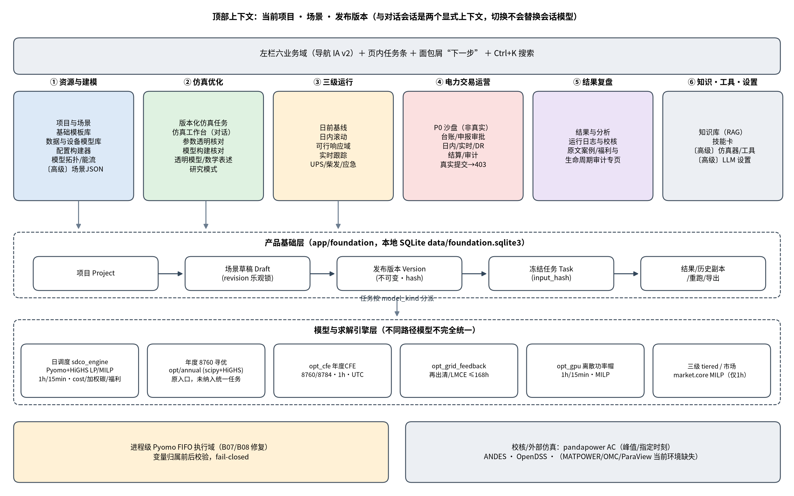
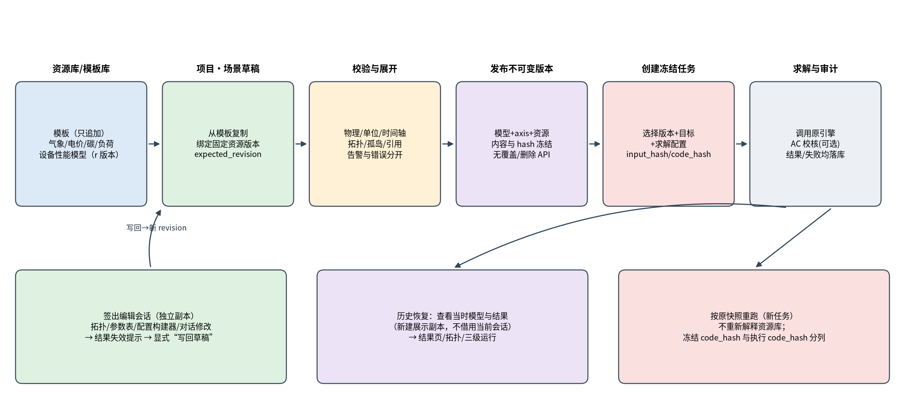
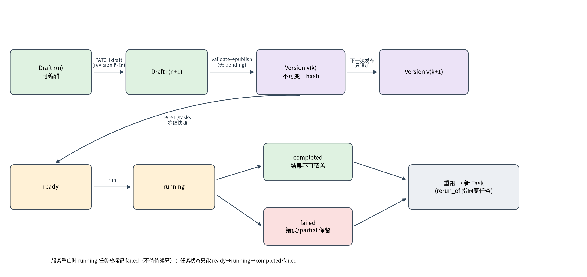
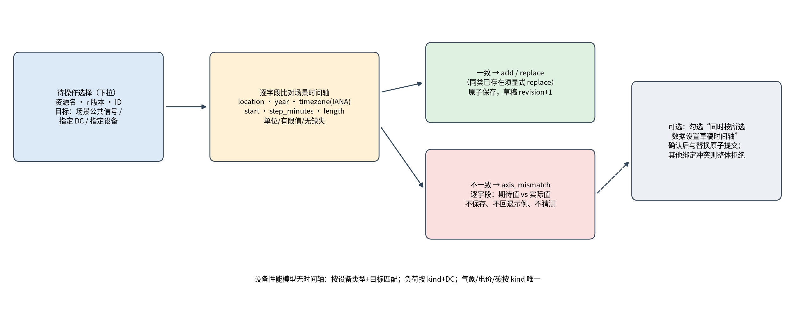
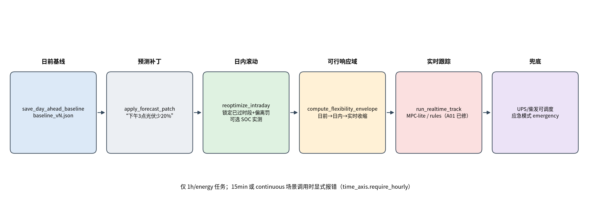
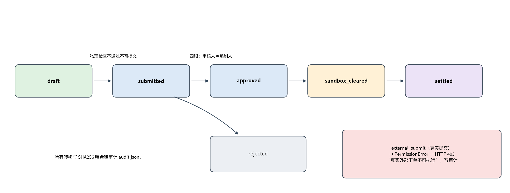
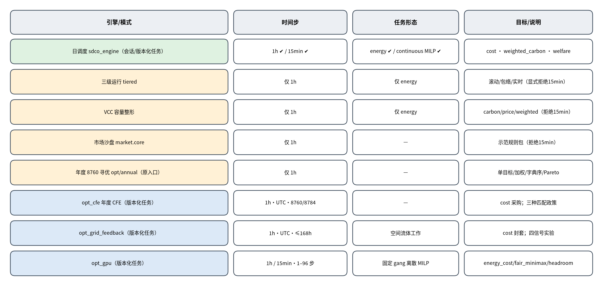
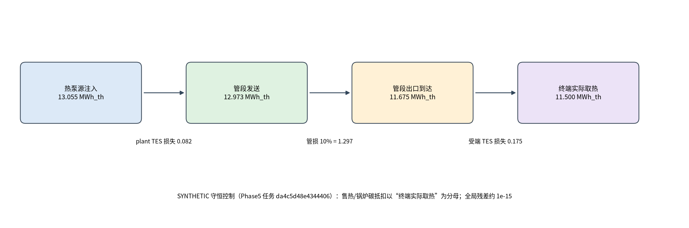
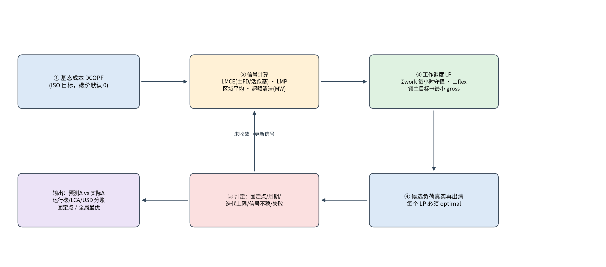
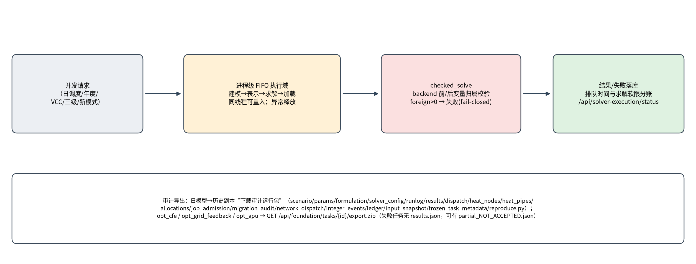

# 1 文档信息

## 1.1 版本、适用范围与读者

Table: 文档基本信息
|项目|内容|
|---|---|
|文档名称|sim-agent 算电热碳耦合仿真与优化平台 · 产品功能设计说明|
|版本 / 日期|V1.0 / 2026-11-10（亚洲/上海，UTC+8）|
|对象系统|本地应用 /workspace/sim-agent（FastAPI 单体 + 原生 JS 单页，服务端口 8080，当前 Mock LLM 模式）|
|代码基线|Phase7 完成后的本地代码；执行 Python 摘要 5067bc78…（取自 2026-11-07 全量测试记录），本次未修改任何业务代码|
|适用范围|产品定位与边界、功能架构与信息分层、核心对象与规则、各功能模块设计、跨模块主路径、关键算法的功能视角、数据对象与冻结/导出规则、已知限制|
|不适用范围|不是使用手册（逐按钮操作仅在必要处给出），不是部署运维手册，也不是逐行技术实现文档；技术栈、路由清单只在附录简述|
|主要读者|产品负责人、研究负责人、模型/算法负责人、验收与质量负责人|
|服务健康|2026-11-10 编写时只读检查 GET http://127.0.0.1:8080/health 返回 {"ok":true,"mock":true}；除此之外未调用任何业务 API|

本文所有时间均为亚洲/上海时区（UTC+8）。外部证据中以 UTC 表示的时间，正文已换算或注明原时区。

## 1.2 审计依据与方法

本说明书采用“先审计、后成文”的方式编写：以当前代码和实际界面为第一依据，以仓库内运行说明和阶段报告为第二依据；两者冲突时以代码为准，并在正文中注明冲突点。2026-11-06 旧文档（/workspace/product-docs-20261106/）只作为章节结构参考，其内容已过时，不作为事实依据。

Table: 审计依据清单
|类别|具体依据|用途|
|---|---|---|
|运行说明|README.md、USAGE.md|产品入口、功能说明、已知局限；其中部分段落停留在 Phase5，已用后续阶段报告和代码校正|
|导航与信息架构|docs/navigation_map.md；app/static/nav.js 中的 IA.DOMAINS；app/static/index.html 左栏|六业务域及其入口；导航文档写于 2026-11-06，代码中已新增“项目与场景/基础模板库/数据与设备模型库/版本化仿真任务”和“原文案例”链接|
|产品基础层|docs/product_foundation.md、docs/product_foundation_ui_fix.md；app/foundation/{api,service,store}.py；app/static/foundation.js|项目—场景—版本—任务对象、绑定、冻结与重跑规则|
|阶段报告|docs/PAPER_REPRODUCTION_PHASE3–7.zh.md；docs/B07_ROOT_CAUSE.zh.md；docs/OPT_CFE / OPT_GRID_FEEDBACK / OPT_GPU_MODEL_CONTRACT.zh.md；docs/BROWSER_REPLAY_PHASE3–7.zh.md|新增模式、修复、独立验收与未完成范围|
|问题登记|docs/issue_register.json（25 项，最新同 issue_register_phase7.json）及各阶段登记|实现状态、剩余范围、阻断项|
|旧审计|/workspace/product-docs-20261106/audit-findings.json（A01–A12）|逐项静态复核当前代码是否已修复|
|模型引擎|app/tools/sdco_engine.py、app/tools/integer_jobs.py、app/heat_audit.py、app/time_axis.py、app/solver_execution.py、app/opt/*、app/opt_cfe.py、app/opt_grid_feedback.py、app/opt_gpu.py、app/market/core.py|算法、目标项、约束与显式拒绝条件|
|测试记录|/workspace/sim-agent-phase7-evidence/current_full_result.json|全量测试口径（截至 2026-11-07）|
|界面截图|/workspace/sim-agent/screens/foundation/（含 retest/）、screens/paper-phase3/、/workspace/product-docs-20261106/screens/|仅引用已有真实截图并注明拍摄日期与一致性|

审计约束：未读取 .env、settings.json 或任何密钥；未修改业务代码；未覆盖历史项目；未用 Shell 驱动浏览器；未回退代码或修改系统代理去抓新图。

## 1.3 状态标注约定

本文对每项功能给出明确实现状态，标注如下。凡是计划、模拟、论文验证专页或部分复现，都不按完整产品能力描述。

Table: 实现状态标注
|标注|含义|
|---|---|
|【已实现】|代码中存在可用入口与完整业务规则，并有回归测试或独立验收证据；不代表已做真实浏览器视觉验收|
|【部分实现】|核心路径可用，但存在明确的范围上限、未覆盖组合或仅部分接入（例如只支持 1h，或只在某个入口可用）|
|【未实现】|产品中没有该能力，或只有占位/存根；需求已识别但未交付|
|【已知缺陷】|已确认存在错误或口径问题且尚未修复，或修复证据不足、需复核|
|【研究可选】|显式开关或独立模式，默认关闭，用于研究对照或论文口径；不改变默认产品行为，也不代表现场可用|

## 1.4 与 2026-11-06 旧文档的主要差异

Table: 与 2026-11-06 旧文档的差异
|主题|旧文档（2026-11-06）|本文（2026-11-10 审计结果）|
|---|---|---|
|产品基础层|无项目/场景/版本/模板/资源库/冻结任务|新增独立 SQLite 基础层：项目、多场景草稿、不可变发布版本、模板与资源只追加版本、冻结任务、历史恢复与重跑；导航新增 4 个入口|
|目标与口径|仅成本与加权碳|新增显式福利出清（welfare）、线路服务费、迁移费 gross/net、可选生命周期分账、paper_abstract 网络域|
|时间步与任务|仅 1h、可切分能量任务（LP）|日调度支持 1h/15min；新增整数连续任务（MILP）与取消/重启损失分账；未适配路径显式拒绝|
|年度与新模式|仅原 8760 寻优入口|新增 opt_cfe（年度 CFE 采购）、opt_grid_feedback（电网再出清与 LMCE）、opt_gpu（GPU 离散功率帽与吞吐 SLA）三种版本化任务模式|
|已修复问题|A01 实时规则电池符号缺陷写为“未修复”|A01 已修复（tiered._rt_rules 按“设施高于信号则放电”，有回归 test_rt_rules_battery_sign_tracks_signal）；另修复 B01 装机容量误报、B05 余热口径、B06 零用电份额、B07/B08 求解变量映射与并发竞态、B02–B04 摘要与时间元数据问题|
|测试口径|当时全量通过|截至 2026-11-07 全量 401 项：392 通过、6 项因缺少 octave-cli/omc/pvpython 失败、3 项因旧基准文件丢失跳过（非全绿）|
|浏览器验收|旧截图 18 张（1280×800）|Phase5 之后的更新因 Chrome 访问 127.0.0.1:8080 出现 ERR_CONNECTION_REFUSED 而未完成视觉验收；Phase4 起多数功能无可持久截图|

## 1.5 测试与验收口径（截至 2026-11-07）

本次编写未重跑全量测试。全量测试的最近一次真实结果来自 2026-11-07 14:27（亚洲/上海）的 Phase7 记录：

Table: 最近一次全量测试结果
|指标|数值|说明|
|---|---|---|
|总数|401|含 Phase7 新增 27 项（全部通过）|
|通过|392||
|失败|6|全部位于 tests/test_multi_sim.py（MATPOWER、OpenModelica×2、ParaView 及两条路由用例），原因是当前环境缺少 octave-cli、omc、pvpython|
|跳过|3|原 /tmp/baseline_fingerprint.json 旧基准文件丢失，未用当前代码伪造旧基准|
|退出码|1|因此不能写成“全绿”|

> 注：独立验收门（如 Phase3 的 21 门、Phase6 的 12 门、Phase7 的 17 门）与 pytest 分别计数，不相互替代；它们证明的是所声明子模型的一致性，不等于论文整篇复现。真实浏览器验收另见 9.1 节。

# 2 产品定位与边界

## 2.1 产品定位

sim-agent 定位为面向数据中心的“算—电—热—碳”耦合仿真与优化平台。它以中文对话驱动研究与决策（规划→建模→运行→校核→修正→报告），并在此之上提供产品化的“项目—场景—版本—任务”闭环，使模型输入、版本、求解与结果可追溯、可复算。

平台的核心价值在于三点：其一，在同一模型中耦合算力负载、电网潮流、机房热/冷却与碳排放；其二，把每次求解的输入、来源、单位、代码与求解器标识冻结下来，支持历史恢复与按原快照重跑；其三，对每个模型口径、假设和失败如实披露，而不是给出“看起来可用”的数字。

虚拟电厂（VPP）运营仍是演进方向：当前“电力交易运营”是示范规则下的沙盘闭环，不连接任何交易中心或调度系统，不构成运营闭环。

## 2.2 目标用户与使用情境

Table: 目标用户与典型诉求
|角色|典型诉求|主要入口|
|---|---|---|
|研究负责人 / 研究员|用一句中文问题驱动建模、对比方案、获得带证据链的结论|仿真工作台、研究模式、结果复盘|
|产品 / 方案负责人|维护多套场景与版本，比较不同配置与目标下的经济性、碳与热安全|项目与场景、版本化仿真任务、配置构建器|
|模型 / 算法负责人|核对数学表述、参数来源、求解状态，扩展新模式|透明模型/数学表述、参数透明核对、运行日志|
|运营策略研究者|在示范规则下演练日前—日内—实时—DR—结算闭环|三级运行、电力交易运营（沙盘）|
|质量 / 验收负责人|核对冻结输入、哈希与导出包，独立重算|版本化任务详情、审计运行包/正式 ZIP|

## 2.3 能力边界

Table: 能力边界：是什么与不是什么
|是|不是|
|---|---|
|日前确定性的算电热碳耦合仿真与优化工具（DC-OPF 线性化 + 可选峰值时刻交流校核）|实时 EMS、SCADA 或在线控制系统|
|项目化的场景/版本/任务管理与审计追溯|多用户、多租户、带权限与电子签章的生产平台（当前无身份认证，仅限可信本地网络）|
|示范规则下的交易与 DR 沙盘|真实交易终端（“真实提交”固定返回 403），也不代表中国正式交易规则|
|论文口径的显式研究模式与部分复现|8 篇论文完整复现（整篇 A 级仍为 0）|
|公开数据 + 等效假设的典型场景（如中卫、韶关、乌兰察布）|现场实测数字孪生或工程设计审查替代品|
|PDF/工程资料的引用与待确认项登记|PDF 自动工程建模（不解析接线图）|

## 2.4 设计原则

- **默认不变、显式启用**：新口径（福利、生命周期、15min、整数任务、paper_abstract、各独立模式）均为显式选择，默认路径与旧结果保持一致。
- **不静默转换**：时间轴、时区、步长、长度、单位、币种不匹配时拒绝，而不是重采样、截断或补值；未适配的组合显式报错，不“按 1h 继续”。
- **版本不可变、只追加**：发布版本、模板版本、资源版本、已完成任务均无覆盖或删除接口。
- **失败如实保留**：求解不可行、限时、未收敛均记录为 failed（必要时保留 partial_NOT_ACCEPTED），不回退使用旧计划、不伪造成功结果。
- **口径分账**：运行碳与生命周期碳、预测与实际、到达热与终端取热、gross 与 net 迁移分列，不把不同边界的数字凑成一个值。
- **对话与界面同源**：对话工具、六步工作流和项目任务调用同一套求解引擎，界面修改会同步到对话上下文。

# 3 总体功能架构与信息分层

## 3.1 六业务域与项目上下文

界面采用“顶部项目上下文 + 一级业务域 + 二级任务”的三层信息架构。顶部条显示当前项目、场景与发布版本；一级为六个业务域，按运营主线 ①→⑥ 排序；二级为左栏分组与页内任务条，高级项默认收起；面包屑给出“下一步”按钮，Ctrl+K 可按名称检索全部入口。

{自制原理图，依据 app/static/nav.js、index.html 与各引擎入口整理；非界面截图。}

Table: 六业务域及入口（以 nav.js 与 index.html 当前代码为准）
|业务域|二级入口|状态|
|---|---|---|
|① 资源与建模|项目与场景；基础模板库；数据与设备模型库；配置构建器；模型拓扑/能流；〔高级〕场景表单（JSON）|【已实现】（设备库首批仅数据中心与储能，见 5.3）|
|② 仿真优化|版本化仿真任务；仿真工作台（对话，六步透明工作流）；参数透明核对；模型构建核对；透明模型/数学表述；研究模式|【已实现】（统一任务对 8760 原寻优未覆盖，见 5.9/5.10）|
|③ 三级运行|三级优化运行（日前基线/日内滚动/可行域/实时跟踪/UPS·柴发/应急）|【部分实现】（仅 1h、能量型任务）|
|④ 电力交易运营|运营工作台（P0 沙盘：台账、申报审批、日内、实时、DR、结算、审计）|【部分实现】（沙盘；真实提交 403）|
|⑤ 结果复盘|结果与分析；运行日志与校核；左栏另有“原文案例/福利与生命周期审计”链接（/paper-reproduction 独立页）|【已实现】（专页为【研究可选】）|
|⑥ 知识·工具·设置|知识库；技能卡；〔高级〕仿真器/工具；〔高级〕LLM 设置|【已实现】（部分外部仿真器当前环境缺失）|

> 文档与代码冲突说明：docs/navigation_map.md（2026-11-06）中“① 资源与建模”只列 3 项、“② 仿真优化”无“版本化仿真任务”；当前 nav.js 已加入项目与场景、基础模板库、数据与设备模型库、版本化仿真任务。本文以代码为准。

## 3.2 主闭环原理

产品化主闭环为：资源库/模板 → 项目场景草稿 → 校验与展开 → 发布不可变版本 → 创建冻结任务 → 求解与审计 → 历史恢复/重跑。编辑通过“签出”产生独立会话副本，修改后需显式写回草稿并重新发布；历史版本和历史任务从不被覆盖。

{自制原理图；依据 app/foundation/service.py 与 docs/product_foundation.md。}

## 3.3 双上下文：项目上下文与对话会话

平台同时存在两个明确的上下文：

- **项目上下文**（顶部条）：选择项目、场景和发布版本，用于发布、建任务、追溯历史。
- **对话会话**（仿真工作台）：智能体在会话内构建/修改模型并求解，原有六步工作流、拓扑编辑、配置构建器、三级运行均基于会话。

两者的关系由规则约束：更换顶部场景不会替换对话中的模型；要让会话编辑某场景，必须“签出草稿”生成独立会话副本；会话修改要回到项目，必须“当前会话模型→写回场景草稿”；旧会话可继续独立使用，或显式“将当前旧会话导入为场景”纳管，系统不会自动迁移旧会话。

## 3.4 导航现状与截图一致性

{拍摄 2026-11-06，Mock 模式；左栏尚无“项目与场景/基础模板库/数据与设备模型库/版本化仿真任务”，与当前导航不一致，仅用于展示对话主界面与六步条。}

{拍摄 2026-11-06 产品基础层 UI 验收，Mock 模式；左栏六域结构与当前导航一致；但 2026-11-07 新增的“⑤ 原文案例”链接以及此后新增的“新建年度CFE/电网反馈/GPU 独立场景”卡片未在图中出现。}

# 4 核心对象与业务规则

## 4.1 对象模型

产品基础层把可变的“草稿”与不可变的“版本/任务”严格分离。所有对象保存在本地 data/foundation.sqlite3 中，以事务方式写入；草稿修改采用乐观并发（必须携带 expected_revision）。

Table: 核心数据对象
|对象|关键字段|可变性|说明|
|---|---|---|---|
|项目 Project|名称、资料引用 documents、待确认项 pending|名称与资料可编辑|资料引用可填标题/URL/知识库 ID；PDF 只登记引用与待确认项，不自动解析接线|
|场景 Scenario（草稿）|draft（model、axis、bindings、device_bindings、provenance、pending）、revision|可编辑（乐观锁）|一个项目可含多套场景；有待确认项时禁止发布|
|发布版本 Version|number、model（已展开）、axis、resources（冻结内容）、bindings、warnings、hash|不可变|发布时展开绑定，内容与摘要固定；无覆盖/删除 API|
|模板 Template|name、source、assumptions、model、hash|只追加|新场景复制模板内容，保留出处|
|通用资源 Library|kind（weather/price/carbon/load/device）、unit、axis、values 或 parameters、source、applicability、previous_id|只追加（修订生成新 r 版本）|绑定引用确定版本；新版本不会自动更新旧场景|
|冻结任务 Task|snapshot（版本模型、目标、求解配置、资源、axis、code_hash、solver_identity）、input_hash、status、result/full_result、error|快照不可变；完成后输出不可覆盖|状态 ready→running→completed/failed；重跑生成新任务（rerun_of）|
|会话 Session|聊天、模型、结果、产物 artifacts/<sid>/|可变|签出副本与历史展示副本都是独立会话|

## 4.2 草稿、发布与不可变规则

{自制原理图；依据 service.py 中 publish、task_new、execute 与 recover_interrupted_tasks。}

业务规则：

- 草稿 PATCH 必须携带 expected_revision，版本号不一致返回“草稿版本冲突”。
- 发布前执行“校验与展开”：绑定资源被展开进模型，生成版本 hash = digest(model, axis, resources)；存在 pending 待确认项时拒绝发布。
- 版本号按场景内顺序递增（v1、v2…），旧版本内容不变；创建任务前会重新核对版本内容与摘要，不一致则拒绝。
- 发布不是工程安全认证：静态校验通过仍可能动态不可行，交流校核与压力验证仍需执行。

## 4.3 签出编辑与写回

1. **签出**：POST /scenarios/{id}/checkout（可选 version_id）总是创建独立会话副本，并在该会话建立项目上下文。
2. **编辑**：在原拓扑编辑器、参数透明表、配置构建器或对话中修改；项目会话中非法的参数/拓扑修改会回滚，旧式会话保留原有编辑行为但发布前仍需严格校验。
3. **写回**：项目页“当前会话模型→写回场景草稿”（POST /sessions/{sid}/save-draft，带 expected_revision）。写回会实体化当前模型并解除草稿中的旧绑定，避免库参数再次覆盖手工修改；旧绑定与基版本记录进入 provenance。需要继续参数化绑定时须显式重新绑定。
4. **发布与运行**：写回后需重新校验、发布新版本并创建新任务，才能得到新模型的结果；历史版本任务仍为原模型与原结果。

## 4.4 绑定与时间轴校验

{自制原理图；依据 POST /api/foundation/scenarios/{id}/bind 的 add/replace 语义与 axis_mismatch 返回。}

Table: 绑定校验字段与规则
|字段|规则|不匹配时|
|---|---|---|
|location 地点|必须与场景草稿一致；跨区需独立建场景|返回 axis_mismatch，逐字段列出场景期待值与数据实际值|
|year 年份|一致||
|timezone 时区|IANA 时区一致（如 Asia/Shanghai）；不转换时区|拒绝|
|start 起点|时间戳一致（含时区偏移）|拒绝|
|step_minutes 步长|日模型：60（24 点）或 15（96 点），且与模型 dt_hours 一致|拒绝隐式重采样|
|length 长度|与模型步数一致|拒绝截断或补值|
|unit 单位|weather=degC、price=CNY/kWh、carbon=tCO2/MWh、load=MW|拒绝|
|values 数值|有限、无缺失；碳与负荷非负；温度在 −90~65 °C|拒绝|
|timestamps（可选）|逐点与 axis 一致、无重复/跳点|拒绝|

绑定类别与目标：气象/电价/碳按 kind 绑定到“场景公共信号”；负荷按 kind + 目标数据中心；设备模型按设备类型 + 目标设备（设备模型无时间轴，不参与时间轴对齐）。同类已存在时“新增”被拒绝，必须显式“替换同类绑定并校验”。可勾选“同时按所选数据设置草稿时间轴”，确认后与替换原子保存；若其他已绑定数据与新时间轴冲突则整体拒绝。失败不保存、不回退示例数据，历史版本不变。

求解前的覆盖语义：价格绑定同时更新场景价格与显式外网价格；气象更新默认/已有区域温度；碳更新实际区域的平均/边际数据；负荷更新目标 DC 的 interactive_mw；设备参数（含分段功率曲线、热性能）覆盖目标设备并重新校验。

{拍摄 2026-11-06 产品基础层 UI 复验（Mock）。示例→公开中卫气象替换时仅 location 冲突被列出；与当前代码行为一致（该区域此后未改动）。}

## 4.5 结果失效规则

- 任一会话模型改变（参数表、拓扑、配置构建器、对话修改），旧 KPI、对比、拓扑结果缓存全部失效；顶部显示“会话修改尚未写回草稿”和“旧结果已过期”，拓扑图不再显示旧解能流。
- 新求解记录实际输入指纹后，状态才恢复为“新鲜”。
- 历史任务结果与当前会话无关，不会因会话修改而失效。

{拍摄 2026-11-06 复验（Mock）：DC_A 的 PUE 由 1.35 改为 1.40 后顶部提示未写回与旧结果过期。}

## 4.6 模板与资源版本

- 模板只追加，新场景复制模板内容并保留来源；首批种子模板 6 个：基础单园区、多数据中心与储能、风光储直供参考·中卫、余热回收参考·中卫、韶关参考、乌兰察布参考。种子模板注明“公开项目资料整理的等值参考/合成工况，非原工程完整接线”。
- 资源修订通过 previous_id 指向不可变前序版本，生成新 r 版本；绑定引用固定版本，资源库更新不会影响已发布版本或已建任务。
- 首批资源种子：明确合成的示例气象/电价/碳/负荷（示例地点、2024-07-01、24 点）与示例储能设备（95% 效率）；从既有公开缓存提取的中卫、韶关、乌兰察布 2024-07-01 Open-Meteo ERA5 2 m 干球温度（记录原 URL、文件路径与 SHA256）。再分析温度不是机房现场测点。
- 设备性能模型首批只支持 data_center（pue、cap_it_mw、power_model、p_idle_mw、p_peak_mw、pdu_breakpoints、thermal 子参数）与 storage（energy_mwh、power_mw、eta_ch、eta_dis、soc0、soc_min、soc_max、reserve_frac），每个参数必须标注规定单位；其他设备仍在场景 JSON 或模板中维护。

## 4.7 冻结、哈希与重跑规则

Table: 冻结与追溯字段
|字段|内容|规则|
|---|---|---|
|snapshot|版本 ID/编号、项目资料、场景出处、绑定、axis、resources、展开后模型、目标、求解配置、code_hash、solver_identity（pyomo/highspy/pandapower 版本）|创建任务时深拷贝冻结|
|input_hash|snapshot 的规范化摘要|运行前复核，不一致拒绝求解|
|code_hash / execution_code_hash|冻结时代码树摘要 / 实际执行时代码树摘要|重跑时两者分别保留；跨代码版本不保证数值一致|
|status|ready / running / completed / failed|只能执行一次；服务重启把 running 标为 failed，不自动续算|
|result / full_result|摘要与完整结果（日模型含 DataFrame 序列化、热指标与调度结果）|完成后不可覆盖；服务重启后可恢复|
|error / error_traceback / partial_result|失败信息与部分过程|失败不回退旧计划；新模式可附 partial_NOT_ACCEPTED|
|rerun_of|重跑来源任务|按原快照重跑，不重新解释资源库|

另有两个摘要规则：日模型导出包中 scenario.json 的输入摘要采用 canonical_export_json_v1，并另存 python_model_hash（B02 修复：默认整数列表与 Pydantic 浮点导出不一致导致的摘要差异）；冻结快照全局 digest 算法未改。

## 4.8 静态校验矩阵

Table: 发布与任务前静态校验
|类别|校验内容|
|---|---|
|设备参数|正容量、PUE、储能效率/SOC/备用比例，温度顺序、热容、COP/冷却边界，分段功率曲线单调且覆盖 0~1|
|拓扑|母线端点、电压等级、线路/变压器参数、无源负荷孤岛；单母线无支路网络可求解（已修复 max(empty) 与 NaN 负载率问题）|
|任务|任务窗口、资源余量、福利模式必须提供 value_cny_mwh 且 carbon_weight=0；连续任务时长/初始进度/允许站点|
|时间轴|24 或 96 点有限数值、单位、地点/年份/IANA 时区/零点/步长一致|
|容量预检（B01 修复后）|区分装机设计上限与固定/同时峰值、必需批任务能量下界；热耦合时只作 IT 下界；真实欠供（如固定 3 MW/电源 2 MW）保留告警且求解失败|
|求解配置|仅 time_limit_s（0~600 s）与 ac_check；paper_abstract 与独立模式必须关闭 AC|

# 5 分模块功能设计

本章按业务域逐一说明各功能模块。每个模块以“功能卡”给出用途、前置条件、操作流程、业务规则、输入输出、异常与审计及关联模块，并给出实现状态。

## 5.1 项目与场景

实现状态：【已实现】（2026-11-06 起；Phase5–7 增加三种独立场景创建入口）

Table: 功能卡：项目与场景
|要素|设计|
|---|---|
|用途|作为资源与建模域的起点：创建项目、维护多套场景草稿、绑定数据与设备版本、校验并发布不可变版本|
|前置条件|服务运行；模板库与资源库已有种子（首次启动自动生成）|
|操作流程|① 输入项目名“创建项目”→ ② 选择模板、填写场景名与时间轴，“从模板新建”（或复制已发布版本、导入结构化 JSON、将旧会话导入为场景）→ ③ 绑定资源（新增/替换）→ ④“校验与展开”→ ⑤“发布不可变版本”→ 进入版本化仿真任务|
|独立模式入口|“创建独立场景”卡片提供：年度 CFE 公开原输入→“新建年度CFE独立场景”；电网反馈预置→“新建电网反馈独立场景”；GPU 预置→“新建GPU离散控制独立场景”。模式参数控件只写入编辑器，须保存草稿→校验→发布后生效|
|业务规则|草稿乐观锁；同类绑定须显式替换；pending 待确认项阻止发布；15min 草稿须“显式展开为15分钟草稿”（有资源绑定须先实体化，否则拒绝），不自动改已保存对象；切换场景/项目时对未保存 JSON 编辑给出确认|
|输入|项目名与资料引用；模板或 JSON；场景 axis（地点、年份、IANA 时区、起点、步长、长度）；资源版本选择|
|输出|场景草稿（revision）；发布版本（number、hash、warnings）；绑定预览（双方时间轴与逐字段差异）|
|异常与审计|axis_mismatch 精确到字段；草稿版本冲突；未知字段/越界参数拒绝；全部写入 SQLite 事务；provenance 记录复制来源、绑定与基版本|
|关联模块|模板库、资源库提供输入；签出→拓扑/参数/配置构建器；发布版本→版本化仿真任务|

{拍摄 2026-11-06 复验（Mock）。发布历史中 v1、v2 并存，旧版本未被覆盖。当前页面另含独立模式创建卡片，图中未显示。}

## 5.2 基础模板库

实现状态：【已实现】

Table: 功能卡：基础模板库
|要素|设计|
|---|---|
|用途|提供可独立复制的参考拓扑与参数结构，作为新场景起点|
|前置条件|无|
|操作流程|浏览模板卡片（名称、来源、假设）→ 在项目页选择模板新建场景；也可由已发布版本另存为模板（POST /templates，带 version_id）|
|业务规则|模板只追加、带 hash；新场景是内容复制，不与模板联动；模板假设默认“参考结构，不能替代工程设计审查”|
|输入/输出|名称、来源、假设、完整场景模型 → 模板记录|
|异常与审计|模型须通过 Scenario 校验才能入库；来源长 URL/JSON 在卡片中自动换行（2026-11-06 UI 修复）|
|关联模块|项目与场景|

{拍摄 2026-11-06 复验（Mock）：模板卡片长来源换行修复后效果。模板种子与当前代码一致。}

## 5.3 数据与设备模型库（通用气象与设备模型库）

实现状态：【部分实现】（时间序列四类已实现；设备库仅数据中心与储能两类）

Table: 功能卡：数据与设备模型库
|要素|设计|
|---|---|
|用途|维护带来源、单位、工况、时间轴与版本的通用资源：气象、电价、碳强度、负荷曲线以及设备性能模型|
|前置条件|资源须给出 name、kind、source、applicability；时间序列须给 axis、values、unit|
|操作流程|新建资源（JSON 编辑器）→ 修订时传 previous_id 生成新 r 版本 → 在项目页绑定固定版本|
|业务规则|单位强制（degC、CNY/kWh、tCO2/MWh、MW）；点数与 axis.length 相等、有限、无缺失；可选 timestamps 逐点一致；设备参数集合受限且逐项单位校验，并代入探针场景做完整校验；不接受未接入求解的“曲线”字段|
|输入|时间序列：axis + values；设备：device_type + parameters + units|
|输出|只追加的资源版本，可在参数透明页显示资源名/版本/ID/原来源/适用工况|
|异常与审计|任何校验失败均拒绝入库；资源种子带原 URL、文件路径与 SHA256|
|关联模块|项目与场景绑定；版本化任务冻结资源内容|

> 限制：首批气象通用绑定只覆盖干球温度；湿度、风光出力等沿用场景已有输入。中卫/韶关/乌兰察布三项目验证属于“公开温度叠加原等值场景”的混合输入测试，不是同一自然日整套现场计量。

{拍摄 2026-11-06 产品基础层 UI 验收（Mock）。资源种子与当前代码一致。}

## 5.4 配置构建器

实现状态：【已实现】（散热方式、余热品位等参数多为文献/假设值）

Table: 功能卡：配置构建器
|要素|设计|
|---|---|
|用途|从零构建“数据中心 + 能源 + 散热 + 蓄能 + 余热供热”配置，或对比/扫描方案|
|前置条件|会话（独立会话或签出编辑会话）|
|操作流程|设置数据中心（数量、IT MW、机柜、利用率、可调比例、散热方式、液冷比例、蓄冷、热泵）、电池、蓄热、虚拟储能开关（预冷/蓄冷/余热/DR）、风/光/火/水/燃气 CHP/外网/PPA、供热末端、管线与热价 →“校验”→“构建为当前会话场景”→ 到工作台 ② 确认参数后求解|
|一键研究|散热方式对比、储能容量扫描、蓄冷容量扫描（夏季）、余热供暖可行性（散热方式×末端×距离）；也可自定义 1–2 个参数网格（点路径，如 dcs.*.cooling_mode、battery.energy_mwh、heat.pipe_length_km）|
|业务规则|散热方式库 6 类（风冷冷冻水、间接蒸发、直接蒸发、冷板液冷、单相浸没、混合），各含送回水温、COP 分段曲线、自然冷却阈值、WUE、余热源温度和安全边界；修改 cooling_mode 按库重设温度边界、辅机电耗与回收比例；风冷单柜超过 25 kW 等给出告警|
|输出|会话场景；KPI 表、柱状图、可行性判定卡（可行/有条件可行/不可行）；产物 cfg_sweep_*.json/md/png、cfg_heat_feasibility.*|
|异常与审计|校验错误阻止构建；扫描结果写入 artifacts|
|关联模块|签出编辑会话中修改后须写回草稿；结果进入结果与分析|

{拍摄 2026-11-06（Mock），早于产品基础层左栏调整；配置构建器页面本身此后未见功能性改动，左栏与当前不一致。}

## 5.5 模型拓扑/能流与编辑校验

实现状态：【已实现】（B01 装机容量误报已修复）

Table: 功能卡：模型拓扑/能流
|要素|设计|
|---|---|
|用途|在运行前核对模型（母线、线路/变压器、电源、储能、数据中心、负荷、迁移链路、热/冷节点），求解后叠加潮流与能流；支持可视化编辑|
|前置条件|当前会话有模型；内置 IEEE14 需先“转换为可编辑网络”|
|操作流程|勾选“编辑模式”→ 点击元件修改并保存 / “添加元件”（母线、线路、变压器、外网、机组、负荷、风光、储能、数据中心、DC 互联、热管理、区域供热网）→“校验”→“重新仿真”（可勾选交流校核）→ 编辑前后指标对比；撤销/重做；保存/加载 JSON|
|业务规则|校验给出中文错误/告警（悬空母线、电压等级不一致、无电源孤岛、PUE、储能时长等），有错误禁止仿真；容量预检区分“装机设计上限”与“固定/同时峰值”“必需批任务能量下界”；15min 结果时间滑块 0–95、末端 23:45|
|输出|拓扑图（潮流箭头/负载率着色）、装机汇总表、日能量桑基图（电→IT→热→冷却→余热→供热）、元件详情 24h 曲线；导出 PNG/交互 HTML/JSON|
|异常与审计|项目会话中的非法修改回滚；任何修改使旧结果失效；能流按 DC 潮流（B-θ）重建，精确电压须用交流校核|
|关联模块|对话（注入“模型编辑同步”说明）、参数透明表、配置构建器、签出写回|

{拍摄 2026-11-07 约 10:00 Phase3 浏览器验收（Mock）：合成回归输入 b01_capacity100.json，装机 100 MW 与固定峰值 1 MW 分列且无欠供误警；为合成反例，非论文精度。}

{拍摄 2026-11-06（Mock），中卫夏季大风会话已求解。左栏为旧版；能流视图本身与当前一致，15min 滑块等后续改动未体现。}

## 5.6 场景表单（JSON，高级）

实现状态：【已实现】

用途是对会话场景做完整参数编辑（数据中心、储能、光伏、电价、碳、任务、链路、热网等），并实时预览碳强度曲线与模型拓扑；回到对话勾选“使用场景参数面板”后发送。字段由 Pydantic Scenario 定义，默认值均为合成示例数据，旧版 JSON 完全兼容。该入口属于会话路径，不直接修改项目草稿。

## 5.7 仿真工作台与六步透明工作流（对话建模）

实现状态：【已实现】（Mock 模式为关键词路由，复杂需求需配置真实 LLM）

Table: 功能卡：仿真工作台
|要素|设计|
|---|---|
|用途|以中文对话驱动建模与求解；右侧六步面板展示 ① 场景与目标 → ② 输入参数 → ③ 模型构建 → ④ 求解配置 → ⑤ 运行与校核 → ⑥ 结果与分析|
|前置条件|LLM 设置（或 Mock）；可选案例预设|
|操作流程|手动：选案例预设与目标（纯成本/成本+碳）→“载入场景→核对参数”。对话：输入需求 → 智能体构建后自动暂停“等待确认参数”→ 在 ② 核对后“确认并继续运行”（可勾选“自动运行”跳过暂停）|
|参数透明（②）|按网络/电源/储能/数据中心与算力负荷/电价与碳/约束/求解器/热管理/余热/DR/碳/时间与任务模式等分组，列出名称、含义、值、单位、合理范围、来源标签（用户指定/智能体推断/默认值/案例假设/公开资料/资源绑定）；越界标红，可直接修改|
|数学表述（④）|KaTeX 渲染本次实际使用的目标项与约束，标注启用/关闭原因、线性化与近似清单、决策变量；求解后显示变量数、约束数、状态、用时|
|运行与校核（⑤）|进度条与运行日志（做了什么、为什么、谁触发、输入、输出摘要、用时、成功/失败）；求解器表（状态、目标、对偶界、Gap）；交流校核（收敛、电压范围、最大负载率、网损、越限）|
|输出|结果（⑥）、可复现运行包 export.zip|
|异常与审计|工具异常回灌给智能体修正参数重试（每工具最多 3 次）；参数确认前不调用求解工具；会话中间 DataFrame 仅存内存（项目任务结果可恢复）|
|关联模块|拓扑、配置构建器、三级运行、研究模式、知识库（每轮自动 RAG）|

对话工具共 47 个（如 build_scenario、run_dispatch、run_ac_check、compute_kpis、run_pareto_sweep、generate_jobs、build_config、run_config_sweep、heat_feasibility_study、submit_objective_spec、run_optimization、check_year_days、三级运行与市场工具、search_knowledge、save_skill_card 等）。注意：opt_cfe、opt_grid_feedback、opt_gpu 三种独立模式目前只能通过项目/版本化任务使用，对话代理中没有对应工具。

{拍摄 2026-11-06（Mock），中卫 zhongwei_summer_highwind 案例；左栏为旧版。参数来源标签含公开资料、案例假设与默认值，并非现场实测输入。之后新增“时间与任务模式”“资源绑定来源”等行未体现。}

{拍摄 2026-11-06（Mock）；左栏为旧版。此后新增福利/整数任务/时间步等约束说明未体现。}

## 5.8 研究模式

实现状态：【已实现】（Mock 下由确定性规则完成形式化/计划/诊断/结论）

研究模式把“一句中文问题”组织成研究闭环：问题卡（研究问题、决策变量、约束、指标、情景、假设）→ 澄清（给出选项与默认值，参数来源可追溯到对话消息）→ 可编辑研究计划（基线/主方案/敏感性/方案比较/压力测试/交流校核）→ 执行·诊断·修订循环（求解状态、PUE、平衡残差、同时购售/充放、热裕度、DR 缺额、末端温度、紧约束与影子价格；不可行时逐项松弛定位并可二分边界，修订最多 3 次，需用户在检查点确认）→ 证据化结论（置信度、证据链 R#、依赖假设 A#）→ 知识沉淀（方法卡/经验卡）→ 报告 study_report.md/html。

规则：所有数字来自运行结果；“为什么/如果…会怎样”追问会重算主方案与同工况基线；研究模式的“修订”是研究诊断重跑，不等同于三级运行中的“日内滚动”。

## 5.9 版本化仿真任务

实现状态：【已实现】（日调度 24h/96 点；8760 原寻优与投资多目标未纳入，见 5.10）

Table: 功能卡：版本化仿真任务
|要素|设计|
|---|---|
|用途|对已发布版本创建冻结任务，调用原求解引擎，保存完整输入、来源、代码与求解器标识及结果，支持追溯与重跑|
|前置条件|顶部选定已发布版本|
|操作流程|选择目标与求解配置 →“创建冻结任务”→“运行所选任务”→ 任务详情（输入/来源/hash/代码与求解器标识）→“查看当时模型与结果”（历史展示副本，可进入结果页/拓扑/三级运行）→“下载任务/输入/结果JSON”或历史副本中“下载审计运行包”→“按原快照创建重跑”|
|目标选项|cost（运行碳权重显式置 0）；weighted_carbon（须给碳权重，默认 1）；welfare（福利出清，须任务报价）。carbon（纯碳）被拒绝：“请使用 weighted_carbon 并明确权重”，不以大权重成本冒充纯碳最优|
|求解配置|time_limit_s ∈ (0, 600] 秒（默认 120）；ac_check（默认开）；独立模式与 paper_abstract 必须关闭 AC|
|业务规则|任务按 model_kind 分派：日模型调用 run_dispatch→sdco_engine.solve、compute_kpis、可选 run_ac_check；opt_cfe/opt_grid_feedback/opt_gpu 调用各自 solve。每任务只能运行一次；任务页每 3 秒只读轮询 /api/solver-execution/status 显示“Pyomo执行域：空闲/持有者/等待队列”|
|输出|result 摘要与 full_result；日模型可恢复 DataFrame、热指标与调度结果|
|异常与审计|冻结输入摘要不一致拒绝求解；求解失败记录 failed，不回退旧计划；服务重启中断任务标 failed，需“按原快照创建重跑”|
|关联模块|项目与场景（版本）、结果与分析、三级运行（历史副本）、审计导出|

{拍摄 2026-11-06 产品基础层 UI 验收（Mock）。当时目标仅成本/加权碳；此后新增 welfare 目标、执行域状态栏与独立模式结果视图，图中未体现。}

{拍摄 2026-11-06（Mock），历史任务从存储中的完整模型与结果恢复为独立展示副本。}

{拍摄 2026-11-07 约 10:00 Phase3 浏览器验收（Mock）：冻结任务输入 hash 与执行 hash 可见。Phase4 之后新增的 dt/整数任务审计字段未体现。}

## 5.10 年度 8760 寻优与多目标（原入口）

实现状态：【部分实现】（原入口可用；未纳入统一冻结任务；仅 1h）

用途是“需求驱动寻优”：对话描述目标与约束（如“经济性最优和碳排放最优的方案及折中”“绿电不低于 90%、回收期不超过 8 年”），系统生成可编辑的目标规格卡，在全年 8760 h（或代表日 + 8760 复核）上联合优化风/光/电池/蓄冷/蓄热/热泵/冷机/散热方式容量与运行，输出帕累托前沿（ε-约束）、单目标、加权和、字典序方案，以及对偶解释、边际减排成本、回收期/NPV。

规则与限制：年度模型为“铜板 + 准稳态冷却”（无 RC 热惯性、无潮流、无 N-1），由年—日闭环 check_year_days 抽选典型/极端日叠加 ERA5 气象跑完整日内引擎复核；投资单价、渗透率等为【假设】量级；年度投资/代表日优化显式拒绝 dt≠1（“禁止隐式按1h”）。该入口仍在会话工作台中使用，不产生项目冻结任务；11-06 审计提出的 A08（固定容量全年复核未重新附加原 spec 全部硬约束）、A08b（代表日容量映射可能遗漏 tes_0/hp_0/chiller_0 命名）、A11（年度功率平衡为 ≥、进口无显式上限，负价下可能无界）本次静态复核未见修复证据，列为【已知缺陷】（见 9.4）。

## 5.11 年度 CFE 采购模式（opt_cfe）

实现状态：【部分实现】（正常项目全链路接通、三组原 8760 输入独立对照通过；完整背景电网与四配置未完成）

Table: 功能卡：年度 CFE
|要素|设计|
|---|---|
|用途|在全年 8760/8784 小时上，对多个站点联合决策风/光容量、电池功率与能量容量及全年运行，满足 CFE/RES 采购政策，最小年化总成本|
|前置条件|项目内“新建年度CFE独立场景”（或 JSON 导入自包含年度模型）；全部剖面与成本自包含在版本中|
|操作流程|设置匹配政策、目标比例、弹性、空间迁移、DSM、超额上限等控件（仅写编辑器）→ 保存/校验/发布 → 版本化任务（cost、关闭 AC、年度默认软限 600 s）→ 运行 → 历史年度结果（UI 预览某站 24 h，完整数据不裁切）→ 正式 ZIP|
|三种匹配政策|paper_cfe_score：年度累计逐小时剔除超额后的 CFE 分数 ≥ x；hourly_cfe_floor：每小时 credit ≥ x·负荷（更强的可选模型）；annual_res_share：年合格风光发电 = x·用电（不代表 24/7 清洁）|
|业务规则|model_kind=opt_cfe；仅 UTC 整年 1 h（平年 8760、闰年 8784），气象年与规划年分列；容量全年只投资一次；绿/灰两类 SOC 跟踪；外网充电按当时 grid_CFE 份额分源；可采购资源须 additional=true 且与站点同竞价区；超额不卖电、从 credit 扣除；负电价输入拒绝|
|显式拒绝|15min、AC、三级运行、日设备/信号绑定、日碳目标/福利目标、长度/闰年/时区/步长/错地域/非新增资源错误；benchmark 短输入（≤168 h）明确标注非全年|
|输出|成本、容量（MW/MWh）、三类份额（年 RES、物理清洁、论文 CFE；分母为 0 时为 null，UI 显示“—（无用电）”）、逐时来源与 SOC|
|异常与审计|ZIP：input_snapshot.json、model.json、task_metadata.json、results.json、hourly.csv、spatial_flows.csv、daily_work.csv、README.json；失败同样导出输入/错误/traceback，不生成假 hourly|
|关联模块|项目与场景、版本化任务、求解执行域|

定量证据（2026-11-07）：三组原 8760 输入（riepin8760_f0、f40、f40_manuscript）正常项目任务成本分别为 473,264,255.77、397,176,972.50、383,708,646.65 EUR，与另写 SciPy 稀疏 LP 的最大差 0.000136 EUR，CSV 守恒最大残差 4.25e-11。f0/f40 匹配作者发布代码的有效拓扑（无 DSM），f40_manuscript 为论文式 6 + 日内 DSM 的显式变体。原作者完整背景欧洲 OPF 只在 DKDEPT 配置 flex0/40 各尝试 600 s，均未达最优、无被接收结果；四配置未全部运行、内生 grid-CFE/LMCE 未纳入。100 MW/站为作者规划假设，非现场计量。

## 5.12 电网再出清与边际碳（opt_grid_feedback）

实现状态：【部分实现】（可回放阶段；真实 RTS 数据仅闰日 4 小时变体）

Table: 功能卡：电网反馈
|要素|设计|
|---|---|
|用途|研究“数据中心按电网信号迁移工作”对系统运行排放与成本的真实影响：基态成本 DCOPF → 计算信号 → 调度工作 → 真实再出清 → 再更新信号|
|前置条件|项目内“新建电网反馈独立场景”或 JSON 导入；仅 UTC 整点、1 h、1–168 小时 benchmark 或 original_data_subset|
|操作流程|配置 selected_signal（主展示信号）、最大迭代、FD 步长、forward_fd/validated_basis、方向导数实验、是否必须收敛 → 写入编辑器 → 保存/校验/发布 → 冻结任务（cost 封套、关闭 AC）→ 查看四信号结果表 → 独立 ZIP|
|四种信号|LMCE（系统运行排放对节点负荷的边际，正负 FD 与活跃基解析导数交叉验证，负值保留）；LMP（ISO 目标对负荷的边际价格）；区域平均碳强度（零出力无定义而非 0）；超额清洁容量（单位 MW，不是吨碳）|
|业务规则|无损连通 DC 网络、硬平衡、硬线路与机组限值，无弃负荷/松弛；每小时 Σwork 守恒、站点 ±flexibility、容量与信赖步长硬约束；工作调度先最小“信号×PUE×工作”，再锁主目标最小 gross；每个 LP 必须 optimal；固定点≠全局最优；不按实际减排择优过滤|
|显式拒绝|15min、完整 8784 年度、年度 CFE 联合、三级滚动、日资源绑定/日拓扑/AC；超长直接校验失败，不截断/不删闰日|
|输出|四策略各自的预测 Δ 与实际 Δ（运行碳、LCA 附加、USD）、迭代过程、固定点状态|
|异常与审计|require_convergence=true 且未收敛时任务 failed，保留 partial_NOT_ACCEPTED.json，无 results.json；ZIP 含 generation/lines/work/migrations/signals/basis/iterations.csv|

定量证据（2026-11-07，12 个独立门通过）：合成三节点负 LMCE 例中 LMCE 策略实际 −0.4 t/+2 USD、LMP 策略 +0.4 t/−2 USD；拥塞例中 average/excess 策略实际增排 +2 t，LMCE 初始预测 −2 t 而实际 0（线性预测失效反例保留）；真实 RTS-GMLC 变体（73 节点/158 机组/120 线路，闰日 4 小时原输入子集）基态 149.20 t 降至四策略最终 0 运行排放，但初始预测约 −546 t 与实际不同。该变体未对齐作者发表版本、小时风光、节点映射和吨制，不是论文 Table I/II 或全年结果。

## 5.13 GPU 离散功率帽与吞吐（opt_gpu）

实现状态：【部分实现】（可验收的局部产品模式；非 Emerald 整篇现场复现）

Table: 功能卡：GPU 离散控制
|要素|设计|
|---|---|
|用途|在固定 GPU 组（gang）上选择离散功率帽/暂停，满足同等工作量、截止期、显式 Flex 窗口吞吐 SLA 与功率预算，最小全时域电费或做公平对照|
|前置条件|“新建GPU离散控制独立场景”；每任务固定、互不重叠的具体 GPU 组；校准动作曲线（cap W、实测/预测 W/GPU、相对吞吐 normalized_rate）|
|操作流程|选择策略、相对 gap、严格留出开关、15min 细化（仅显式把阶梯输入重复 4 次）→ 保存/校验/发布 → 冻结任务（AC 关闭、cost 封套）→ GPU 结果 → 正式 ZIP|
|三种策略|energy_cost：同工作/预算/SLA 下最小电费；fair_minimax：本产品的吞吐余量 minimax 对照变体（不是作者 Fair）；author_dvfs_headroom_discrete：依作者公开 README 伪代码实现的 DVFS 功率 headroom 离散 minimax 版本（非完整 hybrid/resize）|
|业务规则|model_kind=opt_gpu；1h/15min、1–96 步；工作单位为“该任务参考 gang 等效小时”，不同任务不可互换；Flex0/1/2/3 窗口吞吐 ≥100/90/75/50%；Flex0 额外采用参考帽锁定（更保守允许集）；暂停保留进度（可忽略 checkpoint 开销），无 resize/跨站迁移；仅 optimal（含请求 gap）才接收|
|显式拒绝|PUE/热网络/日场景储能等未知字段、共享/resize、错误时间轴、错误工作量/截止；不以 GPU 结果覆盖整 DC PUE、冷却或热安全|
|输出|逐 GPU×时段功率/能量/动作，逐任务进度/浪费容量/累计，SLA 窗口、各阶段 gap|
|异常与审计|严格留出验证（默认开）下任一 deadline/SLA/功率投影违反即 failed，保留 partial_NOT_ACCEPTED；无验证字段时 UI 仅显示“规划一致”，不称留出通过（B12 修复）；ZIP 含 gpu_slots/job_slots/jobs/sla_windows/hourly/solver_phases.csv|

定量证据（2026-11-07，17 个独立门）：九个成功模型与另写 SciPy MILP 的最大费用差 4.55e-13 USD；三个小例另做 27/27/6561 种动作序列穷举；真实校准曲线反事实 1h 为 465.99 kWh，15min 为 452.76 kWh。每任务 6 gang-hour、9 h 时域、idle/pause 100 W、1 USD/kWh 等均为明示的合成/反事实协议，原 33 实验 212 任务未对齐，节电不能外推真实硬件。

## 5.14 三级运行

实现状态：【部分实现】（仅 1h/能量型；A01 已修复；A02–A04、A08–A10 仍存在，见 9.4）

{自制原理图；依据 app/opt/tiered.py 与 app/tools/tier_tools.py。}

Table: 功能卡：三级运行
|要素|设计|
|---|---|
|用途|对齐“日前定基线 → 日内滚动校准 → 实时快速跟踪”与可行响应域理念，并提供 UPS/柴发与应急兜底|
|前置条件|会话已有日前最优结果（含历史任务副本）；场景为 1h、能量型任务|
|操作流程|保存日前基线（baseline_vN.json）→ 预测补丁（如“下午3点光伏少20%”）→ 日内滚动（锁定已过时段、相对基线偏离罚，可选 SOC 实测修正）→ 可行响应域（上/下调包络，日前→日内→实时逐级收缩）→ 实时跟踪（MPC-lite 或 rules，15 min 粒度）→ 负载率↔冷却耦合报告；可配置 UPS（reserve_frac 备用底线）与柴发（连续爬坡，默认 emergency_only），一键应急模式|
|业务规则|默认关闭，不调用则求解路径与旧版一致；roll=None 钩子默认关闭；实时 rules 中设施功率高于信号时电池放电、低于时充电（A01 修复后）；柴发启停成本/最小运行时长仅透明记录，不进目标|
|输出|时间线胶囊、关口对比图、可行域带宽图、跟踪 RMSE、入口温度、SOC 轨迹|
|异常与审计|15min 或 continuous 场景显式报错“三级运行尚不支持15min/整数连续任务”；实时 MPC 求解异常时有显式 rules_fallback 标记|
|关联模块|仿真工作台/版本化任务历史副本 → 三级运行 → 交易沙盘|

> 已知缺陷/待复核（11-06 审计，本次静态复核未见修复证据）：A02 设施功率包络只汇总数据中心 grid_MW，不是含储能与常规负荷的完整关口；A03 无储能场景实时跟踪使用默认 40 MWh 虚拟电池、聚合初始 SOC 不接滚动实测；A10 前端日内按钮固定“光伏降10%”、包络 from_t 固定 8、一键备用以 replace=true 采用默认假设。详见 9.4。

{拍摄 2026-11-06（Mock）：日前基线与日内滚动成功；当时“可行域”停留在计算中，截图不证明可行域完成。左栏为旧版。A01 修复在该截图之前已落地，但实时跟踪截图未在本文引用。}

## 5.15 电力交易运营沙盘与需求响应

实现状态：【部分实现】（沙盘闭环可用；真实提交 403；DR 基线未通过正式结算标准）

{自制原理图；依据 app/market/core.py transition 与 api.py。}

Table: 功能卡：运营沙盘 P0
|要素|设计|
|---|---|
|用途|在示范规则下演练聚合资源的日前—日内—实时—DR—结算闭环，用于方法研究与流程演示|
|前置条件|由案例派生组合（中卫/乌兰察布/韶关）或自建组合；模式固定 sandbox；仅 1h|
|操作流程|台账（DC/储能/UPS/柴发，户号独占校验，跨省资源剔除并记录原因）→ 日前 MILP → 量价申报（买方三段）→ 物理检查 → 审批（四眼）→ 沙盘出清 → 日内重解 → 实时指令分解与 15 min 跟踪 → DR 基线与考核 → 结算复盘；申报导出 CSV/XLSX（标注“非真实”）；导入价格/计量 CSV|
|业务规则|规则包 demo_ningxia/demo_mengxi/demo_guangdong 均为【假设·非官方】，可派生自定义包；日前 MILP 含批处理能量守恒、IT≤冷机 N−1 容量×高温降额、储能/UPS SOC、柴发启停二进制、不倒送；物理检查不通过不可提交；审核人≠编制人；15min 资源显式拒绝|
|真实提交|external_submit 永远返回 HTTP 403“真实外部下单不可执行”，并写拒绝审计|
|DR|基线方法 similar_days_avg（默认）/prior_n_days/adjusted_similar_days；响应率≥阈值按补偿价支付，低于下限按考核价罚；dr_baseline_v2（CAISO 10-in-10、PJM High 4 of 5 等）仅为可选函数，未接 REST/UI/闭环|
|输出|净成本/对照/节省、偏差与考核、DR 申报与响应率、热安全、申报台账与哈希链审计|
|异常与审计|所有写操作写入 SHA256 哈希链 audit.jsonl，可 /audit/verify 校验|

> 诚实说明：公开基准 B4（BDG2 建筑电表 + 伪事件）的独立留出验证中，默认基线与公开改进方法都未能在测试集上同时满足 FN20≤10% 与 FP0≤5%，**DR 基线不能用于正式结算/考核**，只作示范估算。沙盘节省主要来自批处理移峰与储能套利（对照为未优化），不是交易策略超额收益；所有收益为沙盘测算，不代表中国正式交易规则或现场收益。另：11-06 审计 A06（计划量检查不覆盖全部中标段、日内量 clip 后未重做物理优化）、A07（重进页面可能重置导入价格）、A09（批处理需求被截断后仅告警）经 2026-11-10 代码只读复核仍存在（见 9.4）。

{拍摄 2026-11-06（Mock），中卫组合 + 宁夏示范规则沙盘闭环；合成历史与假设价格，非真实交易。左栏为旧版；沙盘页面此后未见功能改动。}

{拍摄 2026-11-06（Mock）：两条申报 settled，哈希链校验完整；“真实提交”按钮可见但未点击。}

## 5.16 结果与分析、运行日志与校核

实现状态：【已实现】

Table: 功能卡：结果复盘
|要素|设计|
|---|---|
|用途|KPI 复盘、基线对比、收益归因、逐时曲线、假设与局限、运行日志与交流校核|
|KPI|成本（不含碳成本）、排放（位置/发电口径）、碳成本、DC 碳强度、绿电率、动态 PUE、入口温度范围与裕度、冷却/蓄冷/余热、DR 要求与实际、任务截止满足率/未完成量/迁移量、链路利用率；福利模式另列接纳价值与服务费；生命周期分账（若启用）|
|收益归因|按“基线 → 仅负荷时移 → +跨中心迁移 → +储能 → +虚拟储冷 → +余热 → +DR”顺序求解反事实 LP 分解节省；分解次序会影响交互效应归属|
|热结果|终端实际用热、管段出口到达、管损、节点储热损失分列（B05 修复）|
|导出|可复现运行包（见 8.2），含 reproduce.py 可用同一引擎重算|
|异常|结果失效后提示“尚无当前结果”；历史任务副本独立展示|

{拍摄 2026-11-06（Mock），中卫夏季大风会话；示例数值，成本为负与外送收入计入目标相关。左栏为旧版；热边界分账等后续 KPI 未体现。}

{拍摄 2026-11-06（Mock）；交流校核仅检查单一时刻。左栏为旧版。}

## 5.17 原文案例/福利与生命周期审计专页

实现状态：【研究可选】（独立页面 /paper-reproduction；只覆盖 Zhang 三节点 7 场景与 Zheng 2019 年度政策）

用途是对论文原始输入运行“显式新模式”并给出独立审计：日调度目标 welfare/cost、网络域 paper_abstract（仅取消论文未定义的相角箱，保留平衡/容量/接纳/迁移约束，不做交流校核）/physical（默认 ±π），迁移费 net/gross，可选生命周期独立分账。Zhang 七场景小时福利 2920/2980/2997.5/3000/3000/3030/3050 与原文一致（正式 CSV 独立重算误差 0）；Zheng 2019 为 8760 小时、546 个固定容量网格的作者无状态优先政策（闭式 LP），生命周期避排 113.4469 kt，与原表差异在 1e-12 量级。页面明确声明“不宣称 8 篇完整复现”，全年模式不是投资/金融寻优或全年网络 OPF。日调度运行仍调用正式 model/load→rerun→results→export.zip 接口。

{拍摄 2026-11-07 约 10:00 Phase3 浏览器验收（Mock）。福利总额 72000、每小时 3000、B=0.5；论文原始输入，非现场数据。专页此后未见改动。}

{拍摄 2026-11-07 约 10:00 Phase3 浏览器验收（Mock）：8760 小时、546 网格；为作者政策的固定网格，不是全年投资优化。}

## 5.18 知识库、技能卡、仿真器与设置

实现状态：【已实现】（外部仿真器部分缺失）

- **知识库**：上传 PDF/DOCX/MD/TXT/CSV/.py/.mo/.m，分块后混合检索：jieba BM25 top20 ∪ 本地 bge-m3 稠密向量 top20 → RRF 融合 → bge-reranker-v2-m3 重排；回答标注“[来源: 文件#块]”。切换嵌入模型后需“重建向量索引”。评测集仅 12 条、语料 26 块，指标只作相对比较（hit@1 0.833、hit@3 1.000）。
- **技能卡**：对话中“记住：…”保存结构化技能卡（任务类型/步骤/参数/校验/示例），类似任务自动检索复用；研究模式沉淀的方法卡/经验卡同样入库。
- **仿真器/工具（高级）**：列出工具注册表与外部仿真器可用性。pandapower、ANDES、OpenDSS 可用；MATPOWER（octave-cli）、OpenModelica（omc）、ParaView（pvpython）在当前环境缺失，相关 6 项测试失败（见 1.5）。
- **LLM 设置（高级）**：OpenAI 兼容 Base URL、API Key（掩码显示）、模型名、Mock 开关、RAG 后端、碳强度来源（synthetic/file/url/carbon_aware_sdk；WattTime 为存根）。保存于 data/settings.json。

{拍摄 2026-11-06（Mock），只读浏览；左栏为旧版。未拍摄任何密钥或设置页。}

# 6 跨模块主路径与典型场景

本章用典型场景说明模块如何串联。所有场景均为“公开数据 + 等效假设”，不是完整现场实测；数字仅用于说明产品行为与口径。

## 6.1 主路径 A：项目化日调度闭环（中卫等效场景）

场景构成：模板“风光储直供参考·中卫”（源自预设 zhongwei_summer_coupled：中卫夏季大风典型日，RC 热模型 + 动态 PUE + 蓄冷罐 + 预冷，碳权重 1，热参数为假设）+ 绑定公开资源“公开气象·中卫·2024-07-01”（Open-Meteo ERA5 2 m 干球温度，非机房现场测点）。风光、任务等未绑定曲线沿用原预设。

1. 资源与建模 → 项目与场景：创建项目 → 从模板新建场景（axis：中卫、2024、Asia/Shanghai、2024-07-01T00:00+08:00、60 min、24 点）。
2. 绑定公开中卫气象（若草稿原为示例地点，按 4.4 节显式替换并对齐时间轴）→ 校验与展开 → 发布 v1。
3. 仿真优化 → 版本化仿真任务：目标 cost 或 weighted_carbon，求解配置默认 → 创建冻结任务 → 运行。
4. 查看当时模型与结果 → 结果与分析（KPI/热安全/归因）→ 运行日志与 AC 校核 → 三级运行（日前基线、日内滚动）。
5. 下载审计运行包；必要时按原快照重跑。

2026-11-06 的验证记录（cases/product_foundation/results/workflow_validation.json）：中卫任务求解 optimal，目标净成本 −2,416,428.7 元（负值来自原场景含售电收入的净成本口径，不是交易策略超额收益），排放 4,650.4 tCO₂，热安全满足；同输入直接求解误差 0.026 元，原快照重跑误差 0。韶关、乌兰察布两套项目同样完成该闭环。

## 6.2 主路径 B：签出编辑 → 写回 → 发布新版本

2026-11-06 复验项目“UI复验-绑定修复-20261106-1336”中，场景“02-编辑写回与结果过期（中卫已匹配）”：签出草稿 → 在拓扑编辑器把 DC_A 的 PUE 由 1.35 改为 1.40 → 顶部提示未写回与旧结果过期 → 写回草稿（草稿 PUE=1.40，v1 仍为 1.35）→ 发布 v2 → 新任务 completed（成本约 2,095,413）；v1 基准任务仍为原结果（成本约 2,091,849）。两者互不覆盖。

{拍摄 2026-11-06 复验（Mock）。}

## 6.3 主路径 C：日前 → 三级运行 → 交易沙盘 → 复盘

会话路径：仿真工作台求解日前最优 → 三级运行（基线/滚动/包络/实时）→ 电力交易运营（组合闭环）→ 结果复盘 → 沉淀技能卡。三级运行与交易沙盘都只支持 1h 能量型场景；两者的模型并不完全相同（交易沙盘使用 market.core 中独立的 scipy MILP，热安全采用“IT≤冷机 N−1 容量×高温降额”的简化），结论不能机械互换。

Table: 运营沙盘案例（seed=7，示范规则【假设】，沙盘测算）
|组合|规则包|资源|净成本（元）|对照（元）|节省|偏差|DR 申报/响应率|热安全|
|---|---|---|---|---|---|---|---|---|
|中卫（剔除上海 SH_EAST）|demo_ningxia|3 DC+ESS+3 UPS+3 柴发|2,272,157|2,482,644|8.48%|2.20%|6.4 MW / 1.30|满足|
|乌兰察布|demo_mengxi|1 DC+ESS+UPS+柴发|985,953|1,172,933|15.94%|1.67%|4.3 MW / 0.87|满足（峰值 25.35 °C）|
|韶关|demo_guangdong|2 DC+2 UPS+2 柴发|1,310,650|1,443,704|9.22%|1.72%|1.9 MW / 1.09|满足（液冷 41.8 °C≤42）|

说明：DR 响应率 >1 部分来自合成计量噪声；韶关液冷批处理 96 MWh 超出热安全可容纳 95.9 MWh 已告警。

## 6.4 主路径 D：年度 CFE 正式任务

项目内“年度CFE公开原输入”下拉 → 新建年度 CFE 独立场景 → 设置匹配政策与弹性 → 保存/校验/发布 → 版本化任务（cost、关闭 AC）→ 运行 → 年度结果（容量、三类份额、逐时来源）→ 正式 ZIP 独立重算。该路径与日调度路径分工：不会建立日会话、不能进入拓扑/AC/三级运行。

## 6.5 主路径 E：研究模式问题闭环

例：“中卫冬季想用余热供暖，看值不值”。研究模式生成问题卡 → 澄清末端类型/管线长度/热价 → 计划（基线/主方案/敏感性/压力测试/AC）→ 执行与诊断（末端温度、热网上限等）→ 证据化结论 → 方法卡/经验卡沉淀 → study_report。余热口径以终端实际取热为准（见 7.5）。

## 6.6 模块间数据交接

Table: 模块间数据交接
|上游|交接对象|下游|规则|
|---|---|---|---|
|模板库|模板模型（复制）|项目场景草稿|复制，不联动|
|资源库|固定版本资源|草稿绑定 → 发布展开|版本固定；新资源版本不影响旧版本|
|场景草稿|签出会话副本|拓扑/参数表/配置构建器/对话|编辑不改版本；写回生成新 revision|
|发布版本|冻结快照|版本化任务|input_hash 复核|
|任务结果|历史展示副本会话|结果与分析、拓扑、三级运行|新副本，不借用当前会话|
|日前结果|baseline_vN|三级运行|仅 1h/能量型|
|案例场景|派生组合|交易沙盘|跨省资源剔除；仅 1h|
|研究结论|方法卡/经验卡|知识库/技能卡|用户勾选采纳后写入|

# 7 关键算法与模型的功能设计

本章从功能视角说明主要模型：目标、约束、参数与单位，以及口径边界。公式为功能级表达，省略部分辅助变量；精确实现以所列源码为准。不同引擎路径（日调度、年度 8760、opt_cfe、opt_grid_feedback、opt_gpu、三级运行、交易沙盘）是各自独立的模型，彼此并不完全统一。

## 7.1 模型族与支持矩阵

{自制原理图；依据各引擎中的显式拒绝条件（time_axis.require_hourly、opt/engine.py、market/core.py、opt_* check_axis）。}

## 7.2 日调度：多时段 DC-OPF 与成本目标

来源：app/tools/sdco_engine.py（solve，目标约在 440–486 行）。模型为多时段直流最优潮流线性规划，含整数连续任务时为 MILP；求解器 HiGHS（经 Pyomo appsi）。

成本主项（元）：

$$ J_{cost} = J_{E} + \sum_{g} d_{g} P^{peak}_{g} + \pi^{un} \sum_{j} U_{j} + \Phi^{th} + \Phi^{DR} $$ {成本主项}

$$ J_{E} = \Delta t \sum_{t \in T} \left[ \sum_{g} c_{g,t} P_{g,t} - \sum_{g} c^{ex}_{g,t} X_{g,t} + \pi^{cur} \sum_{k} \left( \bar{P}_{k,t} - P_{k,t} \right) + \delta \sum_{s} \left( P^{ch}_{s,t} + P^{dis}_{s,t} \right) \right] $$ {电量相关成本}

其中 c 为购电/机组价格（元/MWh），X 为外送电量对应功率（收入为负项），π^cur 为弃电惩罚（默认 500 元/MWh），δ 为储能循环费（合成固定 5 元/MWh-throughput，尚未可配置，见 T02），d_g 为需量电价、峰值功率记为 P^peak_g，二者乘积为需量电费，π^un 为未完成任务惩罚（默认 20000 元/MWh），Φ^th 为热相关惩罚减售热收入，Φ^DR 为需求响应收益/考核。PPA 照付不议按可发电量计费。

完整目标：

$$ \min \, J = J_{cost} + J_{line} + J_{mig} + w \, \lambda_{c} \, \Delta t \sum_{t \in T} E_{t} $$ {日调度目标}

J_line 为显式线路服务费（|潮流|×元/MWh），J_mig 为迁移服务费（gross：双向之和；net：|净迁移|），w 为碳权重，λ_c 为碳价（元/tCO₂，默认 100）。cost 目标在版本化任务中显式置 w=0。

电网约束（功能表达）：

$$ P_{l,t} = b_{l} \left( \theta_{i,t} - \theta_{k,t} \right), \quad b_{l} = \frac{1}{x_{l} \tau_{l}}, \quad \left| P_{l,t} \right| \le \bar{F}_{l} $$ {直流潮流}

其中 τ 为变压器变比（2026-11-06 公开基准 B1a 修复，与 MATPOWER makeBdc 一致；SDCO_DC_IGNORE_TAP=1 仅用于复现旧值）。节点功率平衡、机组上下限与爬坡、外网购售上限、物理域相角箱 θ∈[−π, π]（paper_abstract 模式除外）均为硬约束。储能 SOC：

$$ e_{s,t+1} = e_{s,t} + \Delta t \left( \eta^{ch}_{s} P^{ch}_{s,t} - \frac{P^{dis}_{s,t}}{\eta^{dis}_{s}} \right) $$ {储能 SOC}

日末 SOC 不低于初值。数据中心电网侧功率在 constant_pue 模式为 PUE×IT（可选 idle_dynamic / pdu_pwl 硬件功率模型），coupled 模式由热模型给出逐时动态 PUE。交流校核（pandapower）仅针对峰值或指定时刻，不是全时段交流 OPF。

## 7.3 福利出清与服务费（研究可选）

objective_mode=welfare 时，任务须提供需求报价 v_j（元/MWh），carbon_weight 必须为 0。目标为最大化社会福利：

$$ \max \, W = \sum_{j} v_{j} \left( E_{j} - U_{j} \right) - \left( J_{cost} - \pi^{un} \sum_{j} U_{j} \right) - J_{line} - J_{mig} $$ {福利目标}

接纳与调度均内生，未接纳不再按惩罚计，而是失去报价价值。福利模式在版本化任务中可选，默认 cost 模型不变。G03 审计导出逐 job×时段×目的地分配、接纳、双向 gross/net、报价费用/潮流/相角；可选“锁主目标后最小 gross”（lexicographic_gross，主目标放宽默认 0，公差 ≤1e-4 元，第二阶段失败保留主解并标记）。

## 7.4 碳核算：位置/发电口径、平均/边际与生命周期

逐时碳强度来自区域曲线 κ（tCO₂/MWh）；缺省为全国因子 0.5306 × 合成日内形状 solar_dip（合成）。位置口径：

$$ E_{t} = \sum_{d \in D} \kappa_{d,t} P^{grid}_{d,t} - \left( \epsilon^{b} H^{del}_{t} - \epsilon^{bst} H^{bst}_{t} \right) $$ {位置口径排放}

发电口径用外网区域曲线与本地机组排放因子 Σ ε_g P_g。H^del 为替代锅炉的终端供热，ε^b 为被替代锅炉因子（默认 0.40 tCO₂/MWh_th），H^bst 为燃气补热。carbon_basis 可选 average/marginal（边际曲线需显式给出）。位置口径未扣本地光伏（保守）。

生命周期分账（lifecycle_enabled，研究可选，不改变目标）：

$$ E^{LC} = E^{op}_{gen} + \Delta t \sum_{t} \sum_{k} \ell_{k,t} P_{k,t} + E^{emb} \frac{24}{H_{yr}} $$ {生命周期分账}

ℓ 为 VRE 生命周期强度（tCO₂e/MWh），E^emb 为年度建设隐含碳，H_yr 为年小时数（默认 8760）。可选反事实 jobs_origin_uniform 给出净避排。旧位置口径不被修改，两者分列。

## 7.5 热、冷却与余热

来源：app/tools/thermal.py、sdco_engine.py、app/heat_audit.py。coupled 模式每个数据中心采用两节点 RC 模型（机房空气快节点 + 建筑/机架慢节点），隐式欧拉离散：

$$ C_{a} \frac{T^{in}_{t} - T^{in}_{t-1}}{\Delta t} = P^{IT}_{t} \left( 1 + \frac{\phi}{2} \right) - Q^{room}_{t} - UA_{am} \left( T^{in}_{t} - T^{m}_{t} \right) + UA_{env} \left( T^{out}_{t} - T^{in}_{t} \right) $$ {RC 热平衡}

Q^room 为冷机、自然冷却、蓄冷放冷与热泵取热的净移热，φ 为配电/UPS 等损耗比例（other_frac，默认 0.05）。热安全硬约束：

$$ T^{min} \le T^{in}_{t} \le T^{allow}, \quad \left| T^{in}_{t} - T^{in}_{t-1} \right| \le r^{max} \Delta t, \quad Q^{ch}_{t} \le \frac{n-1}{n} \bar{Q}^{ch} $$ {热安全边界}

默认 T^min=18 °C、推荐上限 27 °C（超出软惩罚 300 元/(K·h)）、T^allow=32 °C、温变率 5 K/h、冷机 N+1。冷机 COP 随室外温度线性变化并限幅：

$$ COP_{t} = \min \left( COP^{max}, \max \left( COP^{min}, COP^{ref} - k \left( T^{out}_{t} - T^{ref} \right) \right) \right) $$ {冷机 COP}

动态 PUE = (IT + 冷却 + 其他)/IT。余热热泵（余热品位模型）COP = η·T_sink/(T_sink − T_evap)，源温不足时由燃气或电补热。

{自制原理图；数值取自 Phase5 合成守恒控制任务 da4c5d48e4344406（SYNTHETIC），不计论文精度。}

余热口径（B05 修复）：多节点热网中，源注入 = 终端取热 + 管损 + 各节点储热损失 + 库存/在途变化；售热与锅炉碳抵扣以“终端实际取热”为分母，管段“到达量”（delivered_mwh 兼容保留，别名 arrived_mwh）是尚未经过受端储热/终端取热的边界，两者不同属于合理边界差异。修复了需求曲线误用旧单节点数组（12）而非节点需求和（11.5）的展示 bug；旧任务不回填。

$$ H^{src} = H^{term} + H^{pipe}_{loss} + \sum_{n} H^{tes}_{n,loss} + \Delta S $$ {热边界守恒}

## 7.6 任务调度与迁移（能量型）

jobs 非空时替代 DC 聚合批处理模型。能量型任务为 LP（可连续切分、可多站同时运行）：

$$ \sum_{d} \sum_{t \in W_{j}} p_{j,d,t} \Delta t + U_{j} = E_{j}, \quad \sum_{d} p_{j,d,t} \le P^{max}_{j} $$ {能量型任务}

W_j 为 [release, deadline) 窗口；links 非空时仅允许沿链路迁移，受带宽（MW）约束，时延敏感任务不能走超限链路；迁入能耗 κ_mig 计入目的地负荷。G03 正式导出逐任务分配与迁移账（见 8.2）。

## 7.7 时间步守恒

Scenario.dt_hours ∈ {1, 0.25}，日总长 24 h，对应 24/96 点。所有能量量按功率×Δt 积分：

$$ E = \sum_{t} P_{t} \Delta t, \quad \Delta t \in \left\{ 1, \, 0.25 \right\} \, \mathrm{h} $$ {时间步积分}

SOC、批任务/任务量、发电能量上限、迁移耗电/费用、线路费、电价/碳/DR/VRE 分账乘 Δt；峰需量费不乘 Δt；MW/h、K/h 坡度乘 Δt；RC 隐式欧拉、TES/储热/热管延迟与每小时损失均按物理小时换算（热管延迟 1 h = 15min 下 4 步）。15min 导出表统一 step/hour/duration_h（hour=step×0.25）；1h 保留整数 hour 格式（B04 修复）。1h 与 15min 最优值不要求相等（离散化与可决策网格不同）。显式“展开为 15 分钟”只做 sample-and-hold，不自动改保存对象。

## 7.8 整数连续任务与取消损失

execution_mode=continuous 的任务使用二进制状态流 MILP（app/tools/integer_jobs.py），不是 LP 四舍五入：每个任务有 pending、running(站点, 进度)、cooldown、done 状态，弧变量 y∈{0,1}：

$$ \sum_{a \in out(j,t,s)} y_{a} = \sum_{a \in in(j,t,s)} y_{a}, \quad p_{j,d,t} = P_{j} \sum_{a \in prod(j,d,t)} y_{a}, \quad U_{j} = E_{j} \left( 1 - \sum_{a \in done(j)} y_{a} \right) $$ {整数状态流}

规则：固定不可分功率、同站连续运行、截止期、历史初始进度（initial_progress_h、initial_dc）；允许重启时取消会丢弃全部已执行进度（无检查点、无无损暂停），可设重启延迟与取消费；required 与软任务分开。账本守恒：

$$ E^{init}_{j} + E^{exec}_{j} = E^{good}_{j} + E^{lost}_{j} + E^{term}_{j} $$ {任务能量账}

Phase4 控制例：初始 1 MWh + 本轮执行 3 = 完成 goodput 3 + 取消损失 1；电费 5 + 取消费 7 = 12，1h 与 15min 一致。MILP 公开界/gap/状态，不提供 LP 对偶。连续窗口不足为真实 infeasible（任务 failed），不伪装为零成本成功。原作者 144 h 滚动与 Azure 原表尚未复现（G04）。

## 7.9 年度 CFE 采购模型

来源：app/opt_cfe.py；合同 docs/OPT_CFE_MODEL_CONTRACT.zh.md；原文 arXiv 2405.00036 p4 式(1)(2)、p5 式(3)、p6 式(5)–(7)。

目标（年化货币，EUR/CNY/USD 须一致）：

$$ \min \, \sum_{r} a_{r} K_{r} + a^{P} P + a^{E} E^{cap} + \sum_{t} \left( \sum_{r} o_{r} g_{r,t} + p_{t} I_{t} + o^{dis} D_{t} + f M_{t} \right), \quad g_{r,t} \le CF_{r,t} K_{r} $$ {CFE 采购目标}

K_r 为风/光容量（MW），P、E^cap 为电池功率（MW）与能量（MWh），全年只有一个容量变量；I_t 为外网进口，D_t 为放电，M_t 为虚拟迁移量，f 为迁移费。清洁电量 credit 定义：

$$ c_{t} = L_{t} - \left( 1 - \gamma_{t} \right) I_{t} $$ {CFE credit}

γ_t 为外网 CFE 份额（0~1，给定值，不是 tCO₂/MWh，也不是内生 LMCE）。三种政策：

$$ \sum_{t} c_{t} \ge x \sum_{t} L_{t} \quad ; \quad c_{t} \ge x L_{t} \, \forall t \quad ; \quad \sum_{t} G^{res}_{t} = x \sum_{t} L_{t} $$ {三种匹配政策}

依次为 paper_cfe_score、hourly_cfe_floor、annual_res_share。x=1 时所有 γ<1 的进口必须为 0，逐小时无清洁缺口；annual_res_share=100% 仍可能白天弃售、夜间购灰电，系统如实显示小时缺口。空间/时间弹性：

$$ \left( 1 - f^{flex} \right) B_{i,t} \le L_{i,t} \le \left( 1 + f^{flex} \right) B_{i,t}, \quad \sum_{t \in day} \left( R_{i,t} - Q_{i,t} \right) = 0 $$ {负荷弹性}

迁移是虚拟工作而非跨区输电；允许同时充放（沿作者线性模型）；超额不卖电并从 credit 扣除。

## 7.10 电网再出清与 LMCE

{自制原理图；依据 app/opt_grid_feedback.py 与 OPT_GRID_FEEDBACK_MODEL_CONTRACT。}

ISO 出清目标（默认碳价 0，即纯经济出清）：

$$ \min \, \sum_{g} \left( c_{g} + \lambda_{c} \epsilon_{g} \right) P_{g} \Delta t $$ {ISO 出清目标}

LMCE 以正向有限差分为主，同时保留负向/半步 FD 与原文(5)(6)活跃基解析导数：

$$ LMCE_{i} \approx \frac{E \left( L + h e_{i} \right) - E \left( L \right)}{h}, \quad E = \sum_{g} \epsilon_{g} P_{g} $$ {LMCE 有限差分}

预测与实际分列：

$$ \Delta E^{pred} = \sum_{i} LMCE^{0}_{i} \Delta L_{i}, \quad \Delta E^{act} = E^{final} - E^{0} $$ {预测与实际排放变化}

正 Δ 为增排。归一化分母 allowed_work=Σε·baseline。actual_cost_delta 只是全系统机组运行费（含显式碳价）的前后差，不是数据中心账单或利润。

## 7.11 GPU 功率帽与吞吐 SLA

每个任务的工作量与动作选择：

$$ W_{j} = \sum_{t} r^{base}_{j,t} \Delta t, \quad \sum_{a} z_{j,t,a} = 1, \quad q_{j,t} \le \sum_{a} \rho_{a} z_{j,t,a} \Delta t, \quad \sum_{t \le D_{j}} q_{j,t} = W_{j} $$ {GPU 工作与动作}

z 为 one-hot 离散动作（功率帽/暂停/完成后 idle/未发布 idle），ρ 为相对吞吐。能量与费用覆盖完整时域与全部 GPU（含未分配、idle、暂停、恢复尾段与固定非 GPU 功率）：

$$ E^{gpu} = \sum_{t} \sum_{u} P_{u,t} \Delta t, \quad C = \sum_{t} \pi_{t} \sum_{u} P_{u,t} \Delta t $$ {GPU 能量与费用}

Flex 窗口 SLA（φ = 1、0.9、0.75、0.5 对应 Flex0–3）：

$$ \frac{\sum_{t \in w} q_{j,t}}{\sum_{t \in w} r^{base}_{j,t} \Delta t} \ge \phi_{j} $$ {吞吐 SLA}

fair_minimax 变体先最小化余量使用比例，再锁定后最小电费：

$$ \rho^{*} = \min \, \max_{j,w} \frac{1 - Q_{j,w} / B_{j,w}}{1 - \phi_{j}} $$ {吞吐 minimax}

能量仍按整槽所选功率计，容量减有用工作记为 wasted_capacity_work_h（保守松弛）。cap 是动作标识，规划功耗来自显式测点，不把 cap 冒充实际功率。

## 7.12 交易沙盘 MILP、DR 基线与结算

日前 MILP（scipy milp/HiGHS）：min Σ价×购电 + 柴发成本 + 储能循环成本，约束含批处理能量守恒、IT ≤ min(cap_IT, 冷机 N−1 容量×(1 − 1%/K·max(0, T_out − 35)))【假设】、储能/UPS SOC（UPS 不低于备用底线）、柴发启停二进制、不倒送。结算：

$$ S = q^{da} p^{da} + \left( q^{id} - q^{da} \right) p^{id} + \left( q^{act} - q^{id} \right) p^{rt} + C^{dev} - R^{DR} + C^{DR} $$ {沙盘结算}

DR 响应率（基线 B、实际 A、申报量 Q^bid）：

$$ \rho^{DR} = \frac{\mathrm{mean}_{t} \left( B_{t} - A_{t} \right)}{Q^{bid}} $$ {DR 响应率}

响应率 ≥0.8（规则包阈值）视为有效。对照为“未优化”（批处理均布、储能不动、不做日内）。B4 基准表明基线误差尾部决定误判率，当前不能用于正式结算。

## 7.13 三级运行算法要点

- 日前基线：在 run_dispatch 结果上导出基线（功率、IT、冷却/蓄冷、DR 承诺、热裕度）并版本化。
- 日内滚动：solve(..., roll=…) 锁定已过时段实际值，重解剩余窗口，目标加相对基线偏离惩罚；可选 SOC 实测更新（soc_source、soc_deviation 透明报告）。
- 可行响应域：固定其他决策，对关口功率做上/下调 max/min LP，按阶段收缩输出 P_up/P_down 与紧约束。
- 实时跟踪：MPC-lite（短视窗）或 rules（冷却 PI 式 + 电池跟踪：设施功率高于信号放电、低于充电，SOC 走廊限制），单节点 RC 校核温度。
- 仅 1h/能量型；不是实时 EMS，ANDES/OpenDSS 仅作校核。

## 7.14 主要参数与单位

Table: 主要参数、默认值与单位（默认值均为合成/假设，须按场景校准）
|参数|默认|单位|说明|
|---|---|---|---|
|dt_hours|1（可 0.25）|h|日调度时间步|
|carbon_factor|0.5306|tCO₂/MWh|全国电网平均因子（合成日内形状）|
|carbon_price_cny_t|100|元/tCO₂|碳价|
|carbon_weight w|0（任务 weighted_carbon 默认 1）|—|成本+w×碳价×排放|
|pv_curtail_penalty|500|元/MWh|弃电惩罚|
|unserved_penalty_cny_mwh|20000|元/MWh|未完成任务惩罚（cost 模式）|
|储能循环费 δ|5（不可配置）|元/MWh|合成常量，T02|
|PUE（数据中心）|1.35|—|constant_pue 模式|
|t_min / t_rec_max / t_allow_max|18 / 27 / 32|°C|入口温度边界|
|ramp_max_k_h|5|K/h|温变率|
|cop_ref / 斜率|5.5 / 0.12|— / 1/K|冷机 COP|
|boiler_ef_t_mwh_th|0.40|tCO₂/MWh_th|被替代锅炉排放因子|
|time_limit_s|120（≤600）|s|求解软限，不含排队/建模/导出|
|grid_CFE γ|输入|0~1|外网 CFE 份额（opt_cfe）|
|GPU idle/pause|输入（反事实 100）|W/GPU|opt_gpu 显式给定|

# 8 接口、导出与审计设计

## 8.1 执行域与求解排队

{自制原理图；依据 app/solver_execution.py、B07_ROOT_CAUSE.zh.md。}

【已实现】B07/B08 修复后，日调度、年度 CFE、VCC、三级运行四类完整 Pyomo 管线进入进程级 FIFO 执行域：同一进程任何时刻只有一个 Pyomo 模型在建模/求解/取值，变量归属在求解前后校验，异常时 fail-closed（任务标记 failed 并保留完整错误）。/api/solver-execution/status 返回当前执行域状态（只读）。求解时限只计算求解器本身，排队、建模、导出另计。依赖的 multiprocessing 延迟回调在任何请求线程前解析（B08），不禁用 RAG。

## 8.2 导出包内容

Table: 各模式审计导出包
|模式|入口|主要文件|说明|
|---|---|---|---|
|日调度（会话/冻结任务）|GET /api/sessions/{sid}/export.zip|scenario.json、params.json、formulation.json、solver_config.json、input_snapshot.json、frozen_task_metadata.json、runlog.json、results.json、dispatch_*.csv、jobs/links/allocations/job_admission/migration_audit/network_dispatch_*.csv、heat_nodes/heat_pipes_*.csv、integer_events/ledger_*.csv、audit_*.json、reproduce.py、README.md|reproduce.py 可脱离服务重算并对比|
|年度 CFE|GET /api/foundation/tasks/{id}/export.zip|input_snapshot.json、model.json、task_metadata.json、results.json、hourly.csv、spatial_flows.csv、daily_work.csv、README.json|回放已存结果，不是重新求解|
|电网再出清|同上|…、signals/basis/iterations/generation/lines/work/migrations.csv、README.json|失败任务导出 partial_NOT_ACCEPTED.json|
|GPU|同上|…、gpu_slots/job_slots/jobs/sla_windows/hourly/solver_phases.csv、README.json|不含 PUE/热证书，不是设备指令|
|交易沙盘申报|GET /api/market/bids/{id}/export.csv / .xlsx|申报单|模板为示意，非交易中心正式格式|

审计字段统一包含 input_hash、execution_code_hash、execution_solver_identity、创建与完成时间；B02 修复后输入摘要采用 canonical_export_json_v1，导出 scenario.json 的独立规范摘要与 execution_context.input_model_hash 逐包相等。

## 8.3 REST 接口概览

Table: 主要 REST 接口分组（2026-11-10 代码核对）
|前缀|主要能力|
|---|---|
|/api/foundation|catalog、projects、scenarios（draft/bind/validate/publish/checkout）、versions、templates、library、tasks（run/rerun/open/export.zip）、sessions/{sid}/context/import/save-draft|
|/api/sessions/{sid}/…|model（init/edit/convert/element/layout/undo/redo/validate/rerun/load）、workflow（confirm/run）、params、solver、formulation、runlog、results、export.zip、config/build/sweep/heat_study、tier（baseline/patch/reoptimize/envelope/realtime/backup/emergency/coupling）、study、calibrate/power、check_year_days、heat/multi|
|/api/opt-cfe、/api/opt-grid-feedback、/api/opt-gpu|presets、presets/{key}、validate（任务经 /api/foundation 运行）|
|/api/market|info、rules、portfolios（from_case/capability/prices/dayahead/loop/import）、dr/baseline、bids（transition/external_submit→403/export）、audit（verify）、runs|
|/api/kb、/api/cards、/api/settings|知识库文档/检索/重建索引、技能卡、设置|
|其他|/api/chat（stream）、/api/scenario/presets、schema、default、/api/jobs/generate、/api/carbon/profile、/api/simulators、/api/time-axis/resample-hourly、/api/paper-reproduction/*、/api/solver-execution/status、/health|

接口无鉴权（A12），默认仅本机使用；不应暴露到公网。

## 8.4 对话工具

对话与研究模式共注册 47 个工具，覆盖场景初始化/预设、模型编辑、参数、求解、结果、AC 校核、配置构建、三级运行、知识库检索、技能卡、研究计划等。opt_cfe、opt_grid_feedback、opt_gpu 三类独立模式目前没有对话工具，只能在项目页操作。Mock 模式下 LLM 回复由规则生成，用于演示与测试，不代表真实大模型效果。

## 8.5 交易沙盘审计链

【已实现】交易沙盘每次申报、状态迁移、结算写入审计日志，每条记录含前一条哈希，形成 SHA256 哈希链；/api/market/audit/verify 校验链完整性。审批流 draft → submitted → approved/rejected → sandbox_cleared → settled，approved 需与提交人不同的审批人（四眼原则）。external_submit 恒抛出 PermissionError 并返回 HTTP 403，没有任何真实交易所连接。

# 9 已知限制、缺陷与路线

## 9.1 测试与验收口径

Table: 当前测试与验收口径（截至 2026-11-07，本次未重跑）
|项|结果|说明|
|---|---|---|
|全量 pytest（2026-11-07 14:27 Asia/Shanghai）|401 项：392 通过 / 6 失败 / 3 跳过，exit 1|6 失败均为 octave-cli、omc、pvpython 缺失（B09）；3 跳过为旧基线 oracle 文件缺失；执行代码哈希 5067bc78…|
|服务健康检查（2026-11-10）|/health 返回 ok、mock=true|仅说明服务可达，不等于浏览器视觉验收|
|浏览器视觉验收|Phase5 之后未完成|Chrome 访问 127.0.0.1:8080 ERR_CONNECTION_REFUSED（B10），根因未定|
|项目基础层 UI 复验|2026-11-06 完成|截图见 4、5 章|
|Phase3 浏览器验收|2026-11-07 约 10:00 完成|B01 容量标签、冻结快照、福利摘要、年度摘要截图|

> 注：因此本文不宣称“全量测试全绿”或“最新界面已全部视觉验收”。Phase4 以后新增的整数任务、15min 迁移表、热边界、年度 CFE、电网再出清、GPU 界面均缺少当前真实截图，本文以原理图代替并标注。

## 9.2 论文复现边界

Table: 论文复现覆盖边界（依据 docs/issue_register.json，as_of 2026-11-07）
|编号|主题|状态|边界|
|---|---|---|---|
|G01|福利出清（Zhang）|【已实现】独立验收通过|7 场景完整福利未全部保持；无多跳中继网络|
|G02|生命周期分账（Zheng 2019）|【已实现】|默认运行碳不变；非全年投资/电网 OPF；8760/546 电网范围未复现|
|G03|逐任务/迁移审计|【已实现】|非 VM 字节/预拷贝网络模型|
|D01|抽象 B/相角域|【已实现】paper_abstract|默认 physical 保留 ±π 相角箱|
|G04|整数连续任务|【部分实现】|日窗口已实现；原作者 144 h 滚动、Azure 原表、Table1 未复现|
|G05|年度 CFE 采购（Riepin）|【部分实现】|3 组原 8760 闭环；完整背景 4 配置未完成，600s 尝试未达最优|
|G06|15min 时间步（SustainDC）|【部分实现】|守恒已实现；原 31 天机架/HVAC/水塔环境未复现|
|G07|GPU 功率帽（Emerald）|【部分实现】|离散变体；hybrid 交错/resize 未实现；原现场 212 jobs 未对齐|
|G08|电网再出清/LMCE（Lindberg）|【部分实现】|闰日 4h 变体；8784 全年闭环 ≤168h 上限拒绝|
|E01|Ma 39 节点双层|【未实现】|原曲线/修改网络未得|
|T01|年度/三级/VCC/市场 × 15min/整数|【未实现】显式拒绝|不静默回退|
|T02|储能循环费 5 元/MWh|【已知缺陷】不可配置|旧合成常量|

八篇论文并未全部完整复现；跨模块耦合（例如 CFE × 电网反馈 × GPU 联合）尚未实现。

## 9.3 运行与实现缺陷

Table: 运行/实现缺陷与修复状态
|编号|问题|状态|
|---|---|---|
|B01|装机容量误当实际负荷峰值产生欠供误报|已修复，峰值与装机分列|
|B02|摘要整数/浮点表示不一致|已修复|
|B03|AC 备用 PV 路径 dt、DR 旧整点合同、热统计双 dt|已修复|
|B04|1h hour 格式与 15min 迁移/网络时间元数据|已修复|
|B05|余热终端/到达分账、多节点需求序列|已修复；旧任务不回填|
|B06|弹性迁移导致份额除零|已修复（份额 null）；浏览器显示待验|
|D02|发布代码剥离 DSM 节点|已查证并分模型|
|B07|Pyomo 共享变量收集器跨线程污染|已修复（FIFO 执行域）|
|B08|tee 锁替换竞态|已修复|
|B09|外部仿真工具缺失，全量非绿|【已知缺陷】未修复（环境）|
|B10|浏览器无法访问 8080|【已知缺陷】未修复（环境）|
|B11|GPU 逐卡 idle 写成平均|已修复，旧任务不回填|
|B12|无独立验证字段时误显示留出通过|已修复文字；浏览器待验|

## 9.4 2026-11-06 审计问题复核（A01–A12）

Table: 2026-11-06 审计问题本次复核结果（2026-11-10 代码只读核对）
|编号|问题|本次结论|
|---|---|---|
|A01|实时规则电池符号|已修复：设施功率高于信号时放电，有回归测试|
|A02|_site_mw 仅加总数据中心 grid_MW|仍存在|
|A03|默认 40 MWh 虚拟电池|仍存在|
|A04|日检查 AC 字段过滤缺 voltage_ok/loading_ok|仍存在|
|A05|dr_baseline_v2 未接入 REST/UI|仍存在|
|A06|check_bid 按 planned 量而非全部中标曲线复解|仍存在（market/core.py check_bid 仍取 planned_mw）|
|A07|交易页每次加载按案例重建组合，历史价格导入不持久|仍存在（market.js loadCap 每次 from_case）|
|A08|verify_full 未重新加约束校核|仍存在|
|A08b|apply_caps 命名歧义|仍存在|
|A09|批量截断最小值警告|仍存在|
|A10|tier.js 硬编码“光伏降 10%”、from_t=8、replace:true|仍存在|
|A11|年度平衡 ≥、无进口上限|未验证|
|A12|无鉴权|仍存在|

## 9.5 产品边界与路线建议

- 规则包为示范，不是中国现行官方规则；交易沙盘不能真实提交。
- DR 基线公开验证未达到正式结算标准。
- 统一冻结任务以 24h 日调度为主；8760/投资多目标需走原入口或年度 CFE 独立模式。
- 建议路线：① 恢复受信运行环境（B09）与浏览器（B10）并补全视觉验收；② 年度/三级/VCC/市场的 15min 与整数适配（T01）；③ 储能循环费可配置（T02）；④ 处理 A02–A12 剩余项与鉴权；⑤ 推进论文剩余范围与跨模块耦合；⑥ 为独立模式补对话工具。

# 10 附录

## 10.1 术语

Table: 术语表
|术语|说明|
|---|---|
|项目/场景/版本/任务|项目基础层四级对象；版本不可变，任务冻结输入快照|
|草稿 revision|草稿的乐观锁序号，写回需匹配|
|绑定（binding）|把资源库固定版本资源接入草稿字段|
|时间轴不匹配（axis_mismatch）|资源与草稿的地点/年份/时区/起点/步长/长度/单位不一致|
|冻结快照|任务创建时的完整输入副本，含 input_hash|
|签出会话|从版本或草稿生成的可编辑会话副本|
|热安全|入口温度/温变率/冷机 N−1 等约束全部满足|
|CFE|无碳电力（carbon-free energy）|
|LMCE|节点边际碳排放（locational marginal carbon emission）|
|goodput|任务实际有效完成的工作量|
|SLA|服务水平约束，此处为吞吐比例下限|
|研究可选|默认关闭、需显式开启的研究性能力|
|Mock|无真实大模型时的规则化对话模式|

## 10.2 符号表

Table: 主要符号
|符号|含义|单位|
|---|---|---|
|Δt|时间步长|h|
|P|功率|MW|
|E|能量|MWh|
|c、p、π|价格/成本系数|元/MWh|
|κ、ε|碳强度/排放因子|tCO₂/MWh|
|λ_c|碳价|元/tCO₂|
|w|碳权重|—|
|θ|节点相角|rad|
|x、τ|线路电抗、变比|p.u.、—|
|T^in、T^out|入口温度、室外温度|°C|
|C_a、UA|热容、换热系数|MWh_th/K、MW_th/K|
|η|充放电效率|—|
|K|新建容量|MW|
|γ|外网 CFE 份额|0~1|
|φ|SLA 吞吐比例下限|—|
|ρ|相对吞吐|—|
|U|未完成能量|MWh|

## 10.3 入口清单

Table: 界面入口清单（依据 app/static/nav.js 与 index.html，2026-11-10）
|域|入口|
|---|---|
|资源与建模|项目与场景、模板库、资源库、配置构建器、模型拓扑、场景 JSON（高级）|
|仿真优化|版本化仿真任务、仿真工作台、参数表、数学模型、求解配置、研究模式|
|三级运行|三级运行|
|运营|电力交易运营|
|复盘|结果与分析、运行日志与 AC 校核|
|工具箱|知识库、技能卡、仿真器（高级）、设置（高级）|
|独立专页|/paper-reproduction 原文案例 / 福利与生命周期审计|

> 注：docs/navigation_map.md（2026-11-06）未包含项目基础层与新增独立模式入口，以代码 nav.js 为准。

## 10.4 参考与证据路径

Table: 主要参考与证据（均为本机只读路径）
|类别|路径|
|---|---|
|产品说明|/workspace/sim-agent/README.md、USAGE.md（README 未覆盖 Phase5 以后内容）|
|项目基础层|/workspace/sim-agent/docs/product_foundation*.md|
|论文复现|/workspace/sim-agent/docs/PAPER_REPRODUCTION_PHASE3–7.zh.md|
|模型合同|/workspace/sim-agent/docs/OPT_*_MODEL_CONTRACT*.md|
|问题登记|/workspace/sim-agent/docs/issue_register*.json|
|根因|/workspace/sim-agent/docs/B07_ROOT_CAUSE.zh.md|
|浏览器回放清单|/workspace/sim-agent/docs/BROWSER_REPLAY_PHASE3–7.zh.md|
|交易沙盘|/workspace/sim-agent/docs/market_ops_p0.md|
|公开基准|/workspace/sim-agent/docs/public_benchmark.md|
|全量测试结果|/workspace/sim-agent-phase7-evidence/current_full_result.json|
|中卫闭环验证|/workspace/sim-agent/cases/product_foundation/results/workflow_validation.json|

## 10.5 截图使用说明

Table: 截图来源与一致性
|来源目录|拍摄时间|模式|与当前界面一致性|
|---|---|---|---|
|screens/foundation/、retest/|2026-11-06|Mock，示例/公开气象|项目基础层主体一致；不含 2026-11-07 起新增的“⑤ 原文案例”链接与独立模式卡片|
|screens/paper-phase3/|2026-11-07 约 10:00|Mock，Phase3 验收项目|Phase3 时界面；Phase4+ 未覆盖|
|product-docs-20261106/screens/|2026-11-06|Mock，中卫等案例|左侧导航为旧版，缺项目基础层入口；功能区内容基本一致|
|本文自制原理图|2026-11-10|—|依据代码与文档绘制，“无当前真实截图”|

所有截图均为本机 Mock 模式实拍，未作修改；未补拍新截图（浏览器访问受阻，B10）。
